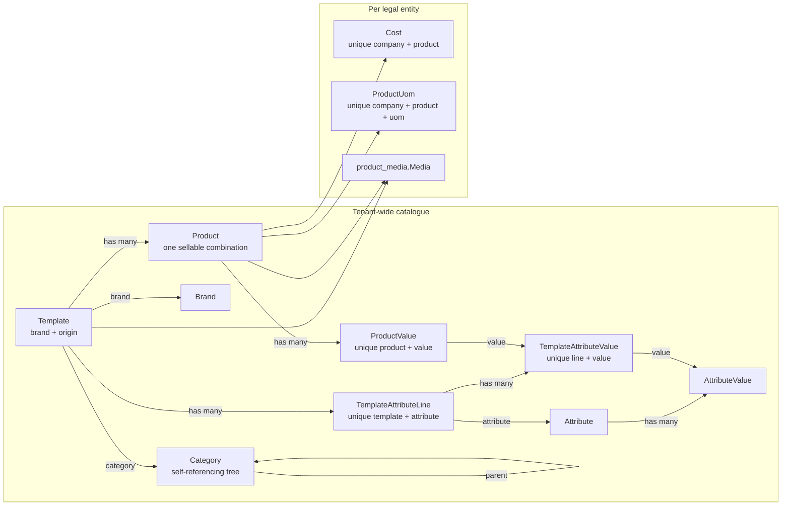

# Product

KetSuite Product is the catalogue every selling and stocking module reads from. It is master data:
one catalogue across the whole tenant, with the values that differ per legal entity — cost and
packaging — kept in company-scoped tables beside it.

## Modules

- `product`: categories, templates, variants, attributes, units of measure per product, and cost.
- `product_media`: ordered images for a template or a variant. Bytes stay with `storage`; the admin
  screens read them through `product_backend`'s image route (see [Permissions](#permissions)).
- `product_backend`: the admin screens and the sidebar entry. Auto-installs once both `product_media`
  and `backend` are present.
- `product_mail_backend`, `product_activity_backend`: chatter and activities on a template.
- `product_variant_mail_backend`, `product_variant_activity_backend`: the same for a variant.

`product` depends only on `uom`. A headless deployment gets the catalogue and its functions with no
admin UI, and installing the admin adds the screens without changing the domain.

## The template and variant split

A `Template` is the thing a person calls a product. A `Product` is one sellable combination of it —
what other systems call a variant. The name reads oddly and is kept deliberately, so the migration
from the domain contract maps one to one.



`ProductValue` is an explicit join rather than a hidden many-to-many: the framework has no magic for
one, and a join you can see is a join you can query, scope and migrate.

## Product type

`Template.type` is `goods` or `service` only.

The domain contract puts three values here — consumable, service, and storable. Storable is a stock
concept, and it would live in a module that must not know stock exists; uninstalling stock would then
leave a value behind that means nothing. KetSuite splits it honestly: `product` says physical or not,
and `stock` extends the template with whether it is tracked. The three original states still map one
to one — service, goods untracked, goods tracked — so a migration is mechanical.

## Company scope

`id` is a tenant-wide primary key, and the engine reads across every company in scope while writing
to exactly one. A company-scoped row therefore carries its company in its id:

| Model | Id | Unique index |
|---|---|---|
| `Cost` | `<company>:<productId>` | `(companyId, productId)` |
| `ProductUom` | `<company>:<productId>:<uomId>` | `(companyId, productId, uomId)` |

A derived id built only from the shared ids would collide between companies on the primary key, and a
lookup that ignores the company finds a row it can never write — the update then filters that row out,
changes nothing, and reports success. Every read of these two models is narrowed to the active company
before it reaches a screen or a write.

## Attribute management

`/admin/product/attributes` uses the shared collection table: compact search across attribute and value
names, display-type and variant-policy filters, pagination, column controls and a create action beside the title. Each row previews up to three
values and opens `product.attribute` in a record modal over the current collection URL.

The single-view modal edits the name, display type, variant policy and ordered values together. The
public `ReorderList` supports drag-and-drop and move-up/down buttons; color attributes expose an
optional `AttributeValue.htmlColor` value. Structural edits and field drafts survive view changes and
validation refusals, and closing a changed record asks before discarding it.

`product.attributeModalContext` checks read/create permissions and returns the complete ordered draft.
`product.saveAttributeDraft` requires configuration permission and saves the parent and values in one
transaction. An attribute may have no values. Supplied values must have distinct, nonblank names;
colors use six-digit hexadecimal notation. Existing value IDs remain stable. Values referenced by a
template cannot be removed, and an attribute used by a template cannot change its variant policy.
The legacy POST endpoints remain available for compatibility; the modal uses the atomic command.

Focused coverage lives in `test/product-attribute-draft.test.ts`, `test/product-attributes-screen.test.tsx`
and the attribute modal and reorder-list tests.

## Variants

`generateVariants` takes the cartesian product of the template's attribute lines, skipping attributes
marked `no_variant`. Each generated variant gets a `combinationKey` — the value ids in a stable order —
and an id derived from it, so regenerating is idempotent. Combinations no longer valid are archived
rather than deleted; they may already be on documents.

A variant has no name of its own. It *is* its combination, so the name is derived from the attribute
values rather than stored, and `listVariants` and `getVariant` return it alongside `values`:

```jsonc
// File: examples/product-variant-name.jsonc
{
  "id": "tpl-jacket:color-blue",
  "combinationKey": "color-blue",
  "name": "Xanh nghiệp vụ",
  "values": [{ "attribute": "Màu sắc", "value": "Xanh nghiệp vụ" }]
}
```

`saveVariant` creates one by hand. It only ever writes `combinationKey` on the way in, or when a
caller names it explicitly: casting it on every edit meant setting a barcode on a generated variant
replaced its combination with a manual key and silently unhooked it from its values.

A template with no configured variant combination still owns one implicit `Product` whose
`combinationKey` is empty. Product-level SKU and barcode edit that default variant. The admin hides it
from the variant table because it is an implementation detail, not a choice the reader can sell. As
soon as real combinations exist, the default variant becomes inactive and the template form keeps its
SKU and barcode read-only with an explanation; identity then belongs on each visible variant.

Brand and origin are template fields. Brand is a managed relation, so another module can reuse the
catalogue without copying brand names into free text; origin remains text because no country-of-origin
catalogue is required by the product domain.

On the product page a template's variants are a card: the attribute lines with their values and
extras, and one row per variant (thumbnail, reference, barcode, price, cost for money readers, what it
can sell and its status). Two commands change them.

**Configure attributes** (`product.configureAttributes`) takes every attribute line of the dialog in
one call. A line is an existing attribute or a name for a new one; each may choose existing values and
name new ones, with a signed price extra per value. The function writes the new attributes and values,
the lines and the variants they make in one transaction, or nothing: a refusal on any line returns the
field paths (`lines.<n>.name`, `lines.<n>.values.<m>.priceExtra`) and leaves no attribute, value or
variant behind. A combination that already exists keeps its variant (id, codes, stock). Adding an
attribute to a product that has variants extends them with the attribute's first value. The product's
own variant (no combination) is not extended: it rests while combinations sell and comes back when every
attribute is removed, as `saveVariantSetup` does. At most 10 lines and 256 combinations.

**Edit variant** sends the whole setup through `product.saveVariantSetup` with only that variant
changed, then its cost through `product.setCost` when it changed. Both are idempotent, so a retried
submit replays.

The `product.variant-editor` island (`ui/client/variant-editor-view.tsx`, bundled to
`client/variant-editor.mjs`) still edits a whole setup as one draft for surfaces that need it; the
product page does not mount it. Its dropdown offers Create attribute to users with both
`product.saveVariantSetup` and `product.saveAttributeDraft`; the shared attribute is saved at once and
the template's setup only on Save.

## Backend screens

`product_backend` owns both the sidebar entry and the pages it points at; a bridge that contributed
only a button would ship a link to a 404.

| Route | Screen |
|---|---|
| `/admin/product/templates` | Catalogue, as a table or cards, with search, filters, grouping and saved searches |
| `/admin/product/templates/new` | Create, on the template record page |
| `/admin/product/templates/{id}` | Product page; `?tab=media` is the server-rendered images page |
| `/admin/product/templates/{id}/context` | The product page's read (JSON), composed from the modules present |
| `/admin/product/templates/{id}/variants/{variantId}` | Variant detail |
| `/admin/product/attributes` | Attributes and their values |
| `/admin/product/images/{attachmentId}` | A product image's bytes, `?size=thumb\|medium\|large` once rendered |

Catalogue rows, kanban cards, global search results and the create action open a template on its
page (`product.template-page`), a client-rendered `RecordPage` (see
[Record pages](/ketsuite/record-modal/#record-pages)), wide whether new or saved. Its header carries
Back, Duplicate, Archive or Restore, and Save changes; there is no breadcrumb and there are no tabs.
`?record=product.template:<id>` links from the earlier modal redirect to the page. The page's guide is
a `HelpDrawer` in the content slot (`screens/template-help.ts`), opened from the rail's Help.

## Product list

The catalogue is three client islands over one paged read (design system: *Collections are client
islands*). The route renders the `ListPage` frame — title, create, actions other modules contribute
through `product_backend:catalogue.actions`, and the screen's guide (`list/help.ts`) — with the
islands in their loading state, each in its slot: `product.template-list-controls` (search, filters,
views, bulk bar) in the controls slot, `product.template-list` (rows or cards and the list's states)
in the body and `product.template-list-footer` (pager) in the footer. In the browser the three share
one store, keyed by the read and the URL as the islands are; the results island reads the first page
and follows the shell's history for all three.

The read is `product_backend.searchTemplates` (`list/read.ts`). The browser sends the list's own URL;
the read parses it against the list's shape, applies it, and answers with one page of rows, the count
behind each preset (a preset's count ignores its own group's choice), the reader's saved searches,
`isEmpty` (nothing recorded, as opposed to nothing matching), and every link the island follows in
place: sort headers, pager, group toggles and group pagers. A page past the end comes back clamped and
the island corrects its URL with `replaceState`; every other decision is a `pushState`, and Back reads
the URL without writing it. The search covers the name, the description, and the code and barcode of
every variant.

Each row carries the code (the default variant's, else the first variant's), category, unit, sales
price, the selling variants, the primary image and, for a viewer with `product.listVariantCosts`, the
margin computed as on the product page.

Stock is not a dependency of `product_backend`. When stock is installed and the viewer may read it,
the list reads through `stock_backend.searchProductTemplates`, which calls the same read with what only
stock knows: **Available** (on hand less reserved over the internal and transit locations of the
company's active warehouses, as on the product page), the sort by it, and the **Out of stock** preset
(tracked products with nothing to sell). Without stock the list has no stock column, sort or preset;
a link carrying them shows the catalogue without them. The saved-search binding uses the same shape.

Selected rows are archived or deleted through `/admin/product/templates/bulk` after a `ConfirmDialog`;
a refused delete (a product already used) returns with `bulkError=delete`, which the list reports once.
A row's link carries `returnTo` with `#row=<id>`, so the product page's way back returns to that row.

## Product page

The page reads `/admin/product/templates/{id}/context` (`modal/product-workspace-context.ts`). The
template comes from `product.templateModalContext`; what other modules know is each module's own
function, read only when that module is composed and the viewer may call it, so a missing one leaves
its card out instead of refusing the page:

| Fact | Function | Shown as |
|---|---|---|
| Stock per active warehouse, each variant's min/max rule, what each variant can sell, whether stock exists | `stock.productWorkspace` | Available and incoming figures, Stock by warehouse table, unit lock |
| Confirmed sales of the last 30 days, in the product's unit | `sale.productSales` | Sold in 30 days |
| Vendor prices valid now, preferred first | `purchase.listProductVendors` | Vendors card |

Revenue, cost, margin and vendor prices are money: a viewer without `product.listVariantCosts` gets
counts but not amounts. The route answers 403 without `product.getTemplate` (or `product.saveTemplate`
when creating), 404 for a missing product, and 405 for anything but GET. From the facts it also returns
the margin (over the selling variants with a known cost), the issues to act on (out of stock, below a
warehouse minimum, price below cost, selling variants without a barcode) and the completeness checklist
(cost counts only for money readers, weight only for goods).

General information, pricing and inventory are one form saved by **Save changes**. The save sends
`product.saveTemplate`, then the cost (`product.setCost`, only when it changed) and stock tracking
(`stock.configureProduct`) as `also` steps whose `when` reads the submitted form; a field another role
owns is disabled with its reason and left out. The sales tax is not on the page: accounting sets it, and
no step of the page writes it, so a save or a duplicate never clears or copies it. The unit
of measure is locked once the product has stock or stock moves. A product with variants keeps its
reference, barcode, measures and cost on each variant.

**Set stock levels** writes the min/max of every variant at one warehouse through
`stock.saveProductOrderpoints`, as `stock.Orderpoint` rows at the warehouse's stock location
(`<warehouse>:stock`) in the product's unit. Every row is checked before any is written. A minimum
alone is also the maximum, a maximum alone starts from zero, and two empty values switch the rule off;
setting it again reuses the same row.

Cards that other modules add follow the form, outside it, because their islands carry their own forms.


Reference fields are relation pickers — a select with a search dialog that can also create the record
it is missing — rather than bare selects. The list functions behind them accept `search` and `limit`,
which is what a picker sends on every keystroke.

Everything the list is doing is in the URL: which page, which search, which view. The back button and
a shared link keep their meaning, and nothing holds state between requests.

Every mutating route refuses a cross-origin POST, and the two detail screens support a partial save
that replaces the record header and body while chatter, activities and the save controller keep their
DOM and their local state.

## Permissions

Reading a product and reading what it cost are separate bundles. `product.view` reads the catalogue;
`product.cost` holds `product.listVariantCosts`, and with it every amount derived from cost: the
list's margin, the product page's revenue, cost, margin and vendor prices, and the variant's cost.
`product.getVariant` leaves the `cost` key out for a viewer without it rather than returning null, the
variant form then has no cost field, and saving a form without that field leaves the cost as it is.

The screens need their own bundles beside `product.view`: `product_backend.view` for the list, or
`stock_backend.view` where stock is installed, because the list then reads through stock;
`product_media.view` for the images; and `product_mail_backend.operate` for the record's activity,
whose posting stays `product_mail_backend.approve`. The shipped job roles carry these. Only the roles
that price, buy or audit carry `product.cost`, and auditors do not get the activity, because following
a record is a write.

The screens show what the viewer may read and leave out the rest, instead of showing a refusal:

- Images come from `/admin/product/images/{attachmentId}`, which asks only for
  `product_media.getMediaAttachment` (`product_media.view`) and answers a file only while an image of
  some product links it; anything else is 404, a refusal included. Storage's `/files/{id}` asks for
  `storage.view`, which reads every file of the company, so the screens do not use it. Without
  `product_media.view` the list's rows and the product page show no picture and no images card.
- The product page's conversation and activity panels are fills of `template.collaboration` that name
  the reads they open with (``, see
  [Extension points](#extension-points)); a viewer without them gets neither panel.
- The shell's inbox and activity counts need `mail.view` and `activity.view` in the same way.

The inventory staff channel returns each product's cost, so it answers 403 to a role without
`product.cost`.


## Verification

```bash
# Run from: ketsuite/
npm run build
node --test .build/test/product.test.js \
  .build/test/product-list-read.test.js \
  .build/test/product-list-screen.test.js \
  .build/test/product-workspace.test.js \
  .build/test/product-modal-view.test.js \
  .build/test/product-variant-editor.test.js \
  .build/test/product-modal-context.test.js \
  .build/test/product-media.test.js \
  .build/test/product-stock.test.js \
  .build/test/product-stock-e2e.test.js \
  .build/test/fill-needs.test.js
```

`product-list-read.test.ts` covers the list read's defaults, clamping, counts, search by code and
barcode, what stock adds, money gating, groups and the empty catalogue. `product-list-screen.test.tsx`
covers the frame, server and first client render, and the island's history (push, replace, Back writes
nothing), its dimming on a slow read and its failure states. `product-workspace.test.ts` covers the facts, the min/max write, configure attributes and duplicate
against SQLite, and the page read over HTTP for a superuser, a reader without money and a user without
the read. `product-stock-e2e.test.ts` boots a real app over HTTP and walks units, variant generation,
media upload and download, pricing and the admin routes.

The browser tests (`ketsuite/e2e/product_backend`, run with `npm run test:product` from
`ketsuite/e2e/`) drive the screens as people use them: the list (search, filters, sort, groups,
pages, cards, selection, bulk archive, saved searches), the product page (figures, rail, editing,
required name, archive and restore, duplicate, create, the screen guide), variants, images, the
attribute and unit screens, English, a phone width, and who may see and change what. Every test runs
under a guard that fails it for anything a person would see go wrong (a refused request, an error on
screen, a message key), and `sweep.spec.ts` reads every screen and dialog that way for each role,
language and width (see `ketsuite/e2e/README.md`).

## Extension points

`product` contributes no UI and knows nothing about stock, sales or accounting. Other modules reach it
through its functions and through named joints on the admin screens:

- `product_backend:template.media` and `variant.media` for extra image tooling;
- `template.recordTabs`, an island fill (``) that the product page renders as a card
  after its form, titled by the filling module's `<module>.productTemplateTab` message and given
  `{ templateId, locale }` (a usage cycle, sales channel listings);
- `template.collaboration` and `variant.collaboration`, which the mail and activity bridges fill. A
  fill names the functions its island opens with in its condition,
  ``; the server page renders the joint
  through `jointFor` (`backend/screen.ts`), which passes `may` with the viewer's answer for each name,
  and the product page's context leaves out a fill whose named function the viewer may not call
  (`ui/fill-needs.ts`);
- `template.editor` and `variant.editor` for the progressive save controller;
- `media.upload` for the upload control itself.

`stock` extends the template with storability and tracking through its own configuration function, so
uninstalling it takes its fields and its part of the form with it.
