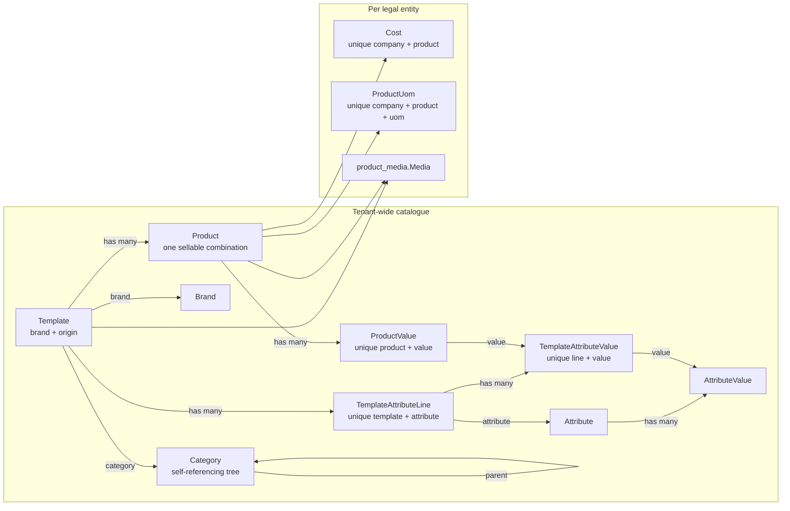

# Product

See [Product imports](product-imports.md) for atomic pasted imports, immutable history and CSV downloads.

KetSuite Product is the catalogue every selling and stocking module reads from. It is master data:
one catalogue across the whole tenant, with the values that differ per legal entity — cost and
packaging — kept in company-scoped tables beside it.

## Modules

- `product`: categories, templates, variants, attributes, units of measure per product, and cost.
- `product_media`: ordered images for a template or a variant. Bytes stay with `storage`; the admin
  screens read them through `product_backend`'s image route (see [Permissions](#permissions)).
- `product_backend`: the admin screens and the sidebar entry. Auto-installs once both `product_media`
  and `backend` are present.
- `product_mail_backend`, `product_activity_backend`: chatter and activities on a template.
- `product_variant_mail_backend`, `product_variant_activity_backend`: the same for a variant.

`product` depends only on `uom`. A headless deployment gets the catalogue and its functions with no
admin UI, and installing the admin adds the screens without changing the domain.

## The template and variant split

The function registry is assembled in `modules/product/functions/index.ts`. Named handlers and their
descriptors live in `templates`, `variants`, `attributes`, `packaging`, `classification`, and `costs`.
Assembly rejects duplicate keys before merging a capability. The former `modules/product/functions.ts`
path only re-exports the registry and its existing transactional/read helpers, so current consumers keep
the same contracts. `test/product-function-contracts.test.ts` records the descriptors and permission
assignments before this refactor; deliberate contract changes must update that baseline after review.

A `Template` is the thing a person calls a product. A `Product` is one sellable combination of it —
what other systems call a variant. The name reads oddly and is kept deliberately, so the migration
from the domain contract maps one to one.



`ProductValue` is an explicit join rather than a hidden many-to-many: the framework has no magic for
one, and a join you can see is a join you can query, scope and migrate.

## Product type

`Template.type` is `goods` or `service` only.

The domain contract puts three values here — consumable, service, and storable. Storable is a stock
concept, and it would live in a module that must not know stock exists; uninstalling stock would then
leave a value behind that means nothing. KetSuite splits it honestly: `product` says physical or not,
and `stock` extends the template with whether it is tracked. The three original states still map one
to one — service, goods untracked, goods tracked — so a migration is mechanical.

The type and the unit of measure are chosen when the template is created and are fixed after.
`product.saveTemplate` refuses a changed `type` (`product.error.template.typeLocked`) or `uomId`
(`product.error.template.uomLocked`) on an existing template; orders, moves and stock already counted
in them would read differently. Resubmitting the same values is fine.

## Company scope

`id` is a tenant-wide primary key. A staff session works in exactly one company (see
[Company và chi nhánh](/ketsuite/company-branch/)), but the engine can still read across every company a
function's scope names while writing to exactly one. A company-scoped row therefore carries its company in its id:

| Model | Id | Unique index |
|---|---|---|
| `Cost` | `<company>:<productId>` | `(companyId, productId)` |
| `ProductUom` | `<company>:<productId>:<uomId>` | `(companyId, productId, uomId)` |

A derived id built only from the shared ids would collide between companies on the primary key, and a
lookup that ignores the company finds a row it can never write — the update then filters that row out,
changes nothing, and reports success. Every read of these two models is narrowed to the active company
before it reaches a screen or a write.

The catalogue models are declared shared. The Commerce deployment composes them through
`companyCatalogueModules`, exported from the package root, so in Commerce every unit, brand, category,
template, variant, attribute and their join rows belong to one company: reads see only the companies in
scope, a lookup of another company's row finds nothing, and a product barcode is unique per company.
`sharedCatalogueModules` gives the shared composition a database has before its split. Other deployments
keep the shared catalogue until they adopt the composition with owner policies of their own.

### Preparing a company catalogue migration

The offline `@ketvietlab/ketsuite/product/company-migration` entry point prepares identities for
an existing shared catalogue. It does not change model scopes or apply a migration.
`inspectCatalogueCompanyIdentities(adapter, originalCompanyId)` reads the applied schema and all
company/catalogue IDs in a transaction, including inactive and unused records. The caller must
use SQLite or PostgreSQL; a caller-owned PostgreSQL transaction must use repeatable-read or
serializable isolation. When it opens its own PostgreSQL transaction, preflight selects repeatable-read
and read-only mode before reading the schema. The caller must
explicitly select the original company; that company retains the existing IDs. Other companies
receive deterministic model-qualified IDs. `planCatalogueCompanyIdentities` accepts the same
inventories without accessing a database. `catalogueIdentityResolver` refuses missing mappings.

The returned plan includes a digest and the typed reference graph from the applied schema, so
deployment extensions remain visible. Shared consumers outside the known catalogue appear in
`unresolvedSharedConsumers`. A plan is only identity evidence: applying a company split additionally
requires policies for encoded IDs, company references on shared records, polymorphic attachments,
immutable channel evidence, data backfill and schema migration. Do not treat an empty unresolved
shared-consumer list as authorization or proof that the data migration is ready. Planning an already
company-scoped catalogue is refused; execution replay must use its persisted migration mapping.

`projectCatalogueCompanyRows({ schema, identityPlan, rows })` projects catalogue copies and operational
references from a complete consistent snapshot of every installed model. It rejects a changed company/ID
inventory, missing or foreign-company references, identity collisions and inconsistent unit ancestry.
The result contains before/after rows, operational identity mappings and pending owner reviews; it never
writes to a datastore. It rewrites variant combination markers, unit paths, cost/quant primary keys,
typed inbound references and polymorphic attachment/thread targets while preserving monetary amounts,
stock quantities, document progress, timestamps and stored file checksums/keys.

The original company keeps every ID, so its rows never need review. A JSON field on a row of another
company, or on a row with no company, requires an explicit owner policy when it carries a catalogue or
rekeyed stock/cost ID as a whole value, an object key or a token delimited by whitespace or
`, ; / ? & = # | " ' ( ) < > [ ] { }` — including receipts without a typed product reference. A
reference that is only encoded, such as hashed or base64, cannot be detected; its owner must declare it.
Hash/digest/fingerprint fields on affected rows of other companies and company references on cloned
catalogue records also remain pending. Their values are preserved. A deployment must resolve
these reviews and adapt runtime lookups before constructing an executable migration; the projection
does not authorize rewriting signed or hashed evidence. Snapshot and projection objects can contain
business data and must remain in the protected migration process, never logs or PR attachments.

Owners settle reviews through `@ketvietlab/ketsuite/company-migration`, an offline entry the package
root never loads. `preserveCatalogueEvidence(projection, fields)` settles the JSON/hash reviews of fields
an owner keeps byte for byte, after checking that nothing recomputes them from their row or resolves a
catalogue ID out of them; company references on catalogue rows stay with their own policy.
`saleCatalogueEvidence`, `posCatalogueEvidence` and `stockStaffChannelCatalogueEvidence` declare the tax,
lot and scan evidence of those modules. `projectCompanyCatalogueWebsiteCards` points every
`website_catalog.product_card` in the live layouts of a copied company (bindings, catalogue templates and
categories, website pages and entry revisions) at that company's template copy, because the storefront
resolves a card through its binding; a field stays pending while anything else in it still names a
catalogue ID, which `catalogueIdDetector(projection)` reports by the projection's own rule. A published
set freezes revision IDs only, so its content hash is unaffected. Deployment modules add their own
policies, and an owner refuses the projection when copying would break work still in progress.

Queued KetJS jobs live in `ket_job`, outside the manifest the projection reads.
`assertNoQueuedCatalogueJobs(projection, jobs)` refuses while a job that a worker can still claim or is
running (`available`, `scheduled`, `executing`, `retryable`) names a catalogue or rekeyed cost/quant ID
in its arguments or unique key and is not scoped to the original company alone. Only the job's handler
knows what its arguments mean, so such jobs are drained before the split rather than rewritten; jobs of
the original company keep working because it keeps every ID.

`settleCatalogueCompanyProjection({ projection, snapshot, policies, jobs })` runs a deployment's owner
policies in order and returns the only projection an executor may apply. A policy may rewrite projected
rows and settle reviews, but changing the catalogue identities or raising a review of its own refuses.
Any review still pending afterwards refuses with the fields named, and the queued-job check runs last.
`publicCatalogueOwnerPolicies` holds the website card rewrite and the sale, POS and staff-scan evidence;
a deployment appends the policies of its own modules after the ones that rebuild rows.

`splitCatalogueByCompany(adapter, { manifest, originalCompanyId, policies, dryRun })` performs the split in
one transaction, as an application-owned KetJS migration. `manifest` is the deployment composed from
`companyCatalogueModules(modules)`: every catalogue model in company scope, with the product barcode
unique per company because copies keep their barcodes. The database must already be on the ordinary
schema; any other difference refuses. The executor reads every table and the queued jobs, settles the
projection, adds the `companyId` columns, copies rows (unchanged columns are copied in SQL from their
source row), moves references, records every changed identity in `product.CatalogueIdentityMapping`, and
lets `confirmManualMigration` verify the physical schema before the marker moves. A refusal rolls back
everything. A dry run returns the statements and counts without writing, and a database already on the
target schema is left alone, so a repeated run is safe.

Runtime commands do not derive the ids of existing catalogue join rows, because copied rows keep opaque
ids. `saveAttributeLine` resolves the template's line by `(templateId, attributeId)` and keeps value rows
by `valueId`; it answers with the held line id and refuses an `id` that already names another
template's line. `saveVariantSetup` updates value rows found by `(lineId, valueId)`, `generateVariants`
reuses variants by combination, and `addTemplateUom` answers with the id of the row holding
`(templateId, uomId)`. Derived ids are only minted for rows that do not exist yet.

## Attribute management

`/admin/product/attributes` uses the shared collection table: compact search across attribute and value
names, display-type and variant-policy filters, pagination, column controls and a create action beside the title. Each row previews up to three
values, shows value and product-usage counts, marks archived definitions, and opens `product.attribute`
in a record modal over the current collection URL. List and record Help explain the same policies in VI/EN.

The single-view modal edits the name, display type, variant policy and ordered values together. The
public `ReorderList` supports drag-and-drop and move-up/down buttons; color attributes expose an
optional `AttributeValue.htmlColor` value. Structural edits and field drafts survive view changes and
validation refusals, and closing a changed record asks before discarding it.

`product.attributeModalContext` checks read/create permissions and returns the complete ordered draft.
`product.saveAttributeDraft` requires configuration permission and saves the parent and values in one
transaction. An attribute may have no values. Supplied values must have distinct, nonblank names;
colors use six-digit hexadecimal notation. Existing value IDs remain stable. Values referenced by a
template cannot be removed or moved to another attribute, and an attribute used by a template cannot
change its variant policy or be archived. The low-level writers enforce the same policies. Definition
edits and product attachment acquire the same attribute row lock. Names are trimmed and unique without
case distinctions within the company; `multi` display requires `no_variant` creation.

Each value has an optional signed `defaultPriceExtra`. New selections copy that default into the
product's `TemplateAttributeValue.priceExtra`; existing selections retain their saved extras when an
update omits the price. Changing a default never reprices another product. Legacy values read as zero;
the additive migration preserves their IDs, names and the existing company lookup index.

Configuration users can confirm archive/restore on unused definitions. Archived definitions remain
visible for restoration but cannot be attached to a new product through any setup writer. Read-only
users receive disabled fields and Help without save or archive actions.
The legacy POST endpoints remain available for compatibility; the modal uses the atomic command.

Focused coverage lives in `test/product-attribute-policy-http.test.ts` (Commerce SQLite/PostgreSQL,
including migration, concurrent names and default extras), `test/product-attribute-draft.test.ts`,
`test/product-attributes-screen.test.tsx` and the attribute modal and reorder-list tests.

## Variants

`generateVariants` takes the cartesian product of the template's attribute lines, skipping attributes
marked `no_variant`. Each generated variant gets a `combinationKey` — the value ids in a stable order —
and a new variant gets an id derived from it. Regenerating finds existing variants by
`(templateId, combinationKey)`, not by that id, so it stays idempotent after a catalogue copy gives
variants opaque ids. A combination that is no longer valid leaves the setup as described in
[Variant lifecycle](#variant-lifecycle). Variants carrying a `manual:`, `archived:` or `pending:` marker
are left alone.

A variant has no name of its own. It *is* its combination, so the name is derived from the attribute
values rather than stored, and `listVariants` and `getVariant` return it alongside `values`. The
values follow the product's line order (attribute sequence, then attribute name), so every variant of
a product names its attributes the same way round:

```jsonc
// File: examples/product-variant-name.jsonc
{
  "id": "tpl-jacket:color-blue",
  "combinationKey": "color-blue",
  "name": "Xanh nghiệp vụ",
  "values": [{ "attribute": "Màu sắc", "value": "Xanh nghiệp vụ" }]
}
```

`listVariants` also returns `displayName`, the product's name followed by those values ("Áo thun
Lớn"), and searches it with accents folded together with the code and barcode. Order lines name a
variant by it (P29): the quotation form seeds its choices from `listVariants` with `saleOk`, so only
variants that sell now are offered, and the variant picker searches the same read, so new, archived
and renamed variants follow the catalogue without a separate list. Typing in the picker asks the
server (`searchInDropdown`) with the same `saleOk` narrowing: the browser's own filter neither folds
accents ("xanh la" would miss "Xanh lá") nor reaches past the 200 preloaded rows. Purchase lines do
the same with `purchaseOk` in the RFQ's line grid, and name their variants by `displayName` too.
Each row also carries `uomId`, its product's own unit, which a line grid's search copies into a new
line (`setsFrom`). A line added without a
name of its own keeps that full name (`describeVariantName`), so the quotation shows "Áo thun Lớn"
rather than just the product. A function that runs the `sale.addLine` or `purchase.addLine`
handler inside its own transaction declares `VARIANT_NAME_EFFECTS`, since naming reads the
attribute tables.

`saveVariant` creates one by hand. It only ever writes `combinationKey` on the way in, or when a
caller names it explicitly: casting it on every edit meant setting a barcode on a generated variant
replaced its combination with a manual key and silently unhooked it from its values.

A template with no configured variant combination still owns one implicit `Product` whose
`combinationKey` is empty. Product-level SKU and barcode edit that default variant. The admin hides it
from the variant table because it is an implementation detail, not a choice the reader can sell. When
the first combinations are configured, that SKU becomes the first combination instead of resting, so
its stock, lots, codes and history stay with a sellable variant; identity then belongs on each visible
variant.

Brand and origin are template fields. Brand is a managed relation, so another module can reuse the
catalogue without copying brand names into free text; origin remains text because no country-of-origin
catalogue is required by the product domain.

On the product page a template's variants are a card: the attribute lines with their values and
extras, and one row per variant (thumbnail, reference, barcode, price, cost for money readers, what it
can sell and its status). Two commands change them.

**Configure attributes** (`product.configureAttributes`) takes every attribute line of the dialog in
one call. A line is an existing attribute or a name for a new one; each may choose existing values and
name new ones, with a signed price extra per value. The function writes the new attributes and values,
the lines and the variants they make in one transaction, or nothing: a refusal on any line returns the
field paths (`lines.<n>.name`, `lines.<n>.values.<m>.priceExtra`) and leaves no attribute, value or
variant behind. A combination that already exists keeps its variant (id, codes, stock). Adding an
attribute to a product that has variants extends them with the attribute's first value. Removing every
attribute keeps one existing SKU as the product without variants. At most 10 lines and 50 active
variants. The same
variant ceiling applies to raw setup, generation and manual SKU creation, before expanding a large
cartesian product or writing rows.

**Edit variant** keeps the three field groups (P28). Whoever holds `product.saveVariantSetup` sends
the whole setup with only that variant changed, then its cost through `product.setCost` and its
packaging barcodes when they changed. Whoever holds only the stock group sends the variant's barcode
and HS code through `product.saveVariantStock`: one transaction, a value left out stays as saved, and
an invalid HS code or a taken barcode writes neither. Whoever holds only the accounting group sends
the cost through `product.setCost`. The other groups' fields stay on screen, locked, under a notice.
All are idempotent, so a retried submit replays.

### Variant lifecycle

`configureAttributes`, `saveVariantSetup` and `generateVariants` share one lifecycle:

- **Original SKU first.** The first configuration gives the existing SKU (empty `combinationKey`) the
  first combination rather than minting a new identity for the same goods.
- **Automatic codes.** A new combination without a code gets the template's `variantCodeBase` (the
  original SKU's code) plus `A`, `B`, … `AA`, skipping every code in the company, archived ones
  included. Renaming the original SKU's code moves the base with it.
- **Delete or archive.** A combination that leaves the setup is deleted, with its costs, packagings and
  barcode claims, only when no installed model references it. Otherwise it is archived and keeps its
  code; choosing the same values again restores the same id.
- **Guards.** Removing or archiving a variant with stock or reservations, or on an unfinished sale,
  purchase, POS, stock or draft accounting document, is refused as `product.error.variant.stocked` or
  `product.error.variant.openDocuments` with `params.variant` naming it; archiving the last active
  variant is `product.error.variant.lastActive`. The whole setup rolls back.
- **Concurrency.** Each writer takes the template's revision lock before reading the setup, and the
  same `revisionId`/`inventoryRevision` claim stock writers use, so a configuration racing a stock
  write or another configuration loses with `conflict` instead of retiring a SKU that just received
  stock.
- **Price and customs code.** A variant sells at the template's `listPrice` plus the `priceExtra` of
  the values it is made of, unless `listPriceOverride` is set; pricelist rules based on `list_price`
  and orders without a rule start from that price. A `fixed` rule applied to the whole product
  (`1_product`) adds the variant's extras (`variantPriceExtras`); a `fixed` rule for one variant does
  not. Readers call `variantSalePrice` and declare `VARIANT_PRICE_EFFECTS`. `saveVariantSetup` accepts `listPrice` (a non-negative decimal or `null`)
  and `hsCode` (4–10 digits after dots and spaces are dropped) per variant; omitting either keeps the
  stored value. Changing `hsCode`, like `barcode`, needs the `stock` field group.
- **Duplicate.** `templateModalContext({ sourceId })` returns `duplicateLines` and `duplicateCount`
  to a viewer who may configure attributes. The create command passes those lines to
  `configureAttributes` after the template exists, so the copy gets its own variants and codes.

Deletion only trusts references the function declared. A model outside the composition is never
evidence of no usage, so a deployment whose own modules reference `product.Product` passes their model
names when composing:

```ts
// File: examples/product-variant-references.ts
import { companyCatalogueModules, productReferenceModels } from '@ketvietlab/ketsuite'
import { models as deliveryModels } from './modules/delivery/models.js'

const modules = companyCatalogueModules(
  [/* modules */],
  productReferenceModels('delivery', deliveryModels),
)
```

`withProductVariantReferences(modules, extra)` does the same for a deployment that does not use the
company catalogue. A referencing model that is not declared makes the variant archive, never delete.

The `product.variant-editor` island (`ui/client/variant-editor-view.tsx`, bundled to
`client/variant-editor.mjs`) still edits a whole setup as one draft for surfaces that need it; the
product page does not mount it. Its dropdown offers Create attribute to users with both
`product.saveVariantSetup` and `product.saveAttributeDraft`; the shared attribute is saved at once and
the template's setup only on Save.

## Backend screens

`product_backend` owns both the sidebar entry and the pages it points at; a bridge that contributed
only a button would ship a link to a 404.

| Route | Screen |
|---|---|
| `/admin/product/templates` | Catalogue, as a table or cards, with search, filters, grouping and saved searches |
| `/admin/product/templates/new` | Create, on the template record page |
| `/admin/product/templates/{id}` | Product page; `?tab=media` is the server-rendered images page |
| `/admin/product/templates/{id}/context` | The product page's read (JSON), composed from the modules present |
| `/admin/product/templates/{id}/variants/{variantId}` | Variant detail |
| `/admin/product/attributes` | Attributes and their values |
| `/admin/product/categories` | Category tree paths, inherited accounts and active product counts |
| `/admin/product/images/{attachmentId}` | A product image's bytes, `?size=thumb\|medium\|large` once rendered |

Catalogue rows, kanban cards, global search results and the create action open a template on its
page (`product.template-page`), a client-rendered `RecordPage` (see
[Record pages](/ketsuite/record-modal/#record-pages)), wide whether new or saved. Its header carries
Back, Duplicate, Archive or Restore, and Save changes; there is no breadcrumb and there are no tabs.
`?record=product.template:<id>` links from the earlier modal redirect to the page. The page's guide is
a `HelpDrawer` in the content slot (`screens/template-help.ts`), opened from the rail's Help.

## Category lifecycle

`product.saveCategory` trims and NFC-normalizes names, limits them to 40 characters and rejects `/`.
Names are case-insensitively unique under the same parent, including archived siblings. A parent
must be active and outside the node's descendants. Relationships remain ID-based.

`product.setCategoryActive({ id, active })` uses the catalogue configuration permission. Archival
is refused while the subtree contains active products, an active direct child, or category rules
belonging to active pricelists. Restoring a child requires an active parent. Neither action deletes
historical references or requires edit-form fields. Ordinary category choices omit archived rows;
`includeArchived` includes them and explicit `ids` lookups retain historical labels and paths.

Product creation/reassignment, duplication and restoration, category reparenting, rule assignment
and pricelist activation share transactional category locks with archival. Concurrent changes can
return a conflict and must be retried from fresh state. Category tree edits lock existing nodes in
stable ID order; sibling identity also has a unique database key scoped to the company in Commerce.

The additive schema keeps `active` and `nameKey` nullable for existing catalogues: null activity means
active, and legacy names/duplicates remain unchanged. Reads normalize activity; edits check legacy
names before claiming the new unique key. No destructive backfill is needed.

The category collection is available from Settings and uses three client islands over one bounded
`product_backend.searchCategories` read (50 rows by default, maximum 100). Search matches full paths
with or without accents; active/archived/all, sorting and paging stay in the URL. Counts include
active products in descendants. The server currently projects the company's scoped category tree
in memory; bounded browser pages are not a claim of database-level pagination.

Every Commerce screen that names a product's category uses its full path ("Skin care / Cleansing"),
since two branches may hold the same name: the product page picker, the product and variant lists
(column, filter and group labels), pricelist category rules and the invoicing-policy table.
`categoryPaths(rows)` in `product/category-tree.ts` derives them; `product.listCategories` returns
the same value as `path`.

`product.category` is a native record modal with English/Vietnamese Help. Owners and sales managers
can edit name/parent and accounts; accountants can edit only account fields; catalogue readers see
facts. `account.category-accounting` grants this narrow mapping capability without account-master
administration. Archived records are read-only and show Restore to configuration users. Archive
and Restore use native confirmation dialogs and refresh the record after closing confirmation.

`product.saveCategoryRecord` checks field-group permissions and a revision derived from category
identity/activity and account mappings. It writes general and accounting fields in one transaction;
account refusal rolls back the name/parent too. Forged unauthorized field changes return HTTP 403;
a stale revision returns a translated field refusal and preserves the draft. Reopen the record to
compare fresh state before retrying. Concurrent storage conflicts still use the locked framework's
transport status; this UI does not assert HTTP 409 support.

Empty account fields inherit the nearest configured ancestor, then company defaults; product
account overrides remain first. Expense defaults depend on product type, so the list says Company
default when there is no category mapping instead of inventing one expense account. Inactive account
choices are excluded except an already-held mapping whose label must remain visible.

## Product tags

Tags classify a product across categories. `product.Tag` and ordered `product.TemplateTag` links
follow the deployment's catalogue scope; Commerce keeps both per company. Tag names are trimmed,
NFC-normalized, at most 30 characters and case-insensitively unique, including archived tags.
The schema is additive (Product 0.2.8) and does not backfill or rename existing products.

`product.saveTag` creates/renames a tag. Updates and `product.setTagActive` require the current
`expectedRevisionId`; both require catalogue configuration. `product.listTags` is available to
catalogue readers, omits archived rows by default, and retains them for `includeArchived` or explicit
`ids` lookup. An archived tag must be restored before renaming. Tags have no cosmetic colour field.

`product.saveTemplate` and the atomic `product.saveRecord` accept optional `tagIds`, an ordered array
of at most ten distinct IDs. Omitting it preserves attachments; an empty array clears them. Assigning
a missing, foreign-company or newly archived tag is refused. Tags already carried by that product
may stay after archival. Tag changes require the general field permission, share the product revision
and transaction, and are read back by `product.getTemplate`. Assignment and archival lock tags in
stable ID order; concurrent storage conflicts follow the installed framework's transport contract.

Duplicating a product copies its tag order/history into independent links, including a tag already
archived on the source. Deleting an eligible product removes only its links; tag definitions and
other products' links remain. The create-from-source page sends `duplicateSourceId` to `saveRecord`;
that create-only path checks both duplicate/read permissions and company scope before retaining
source tags. Invalid source or tag input rolls back the complete create.

Settings → Product → Tags opens `/admin/product/tags`: a paged client collection with name search,
status counts and sorting, plus a native record modal for create, rename, archive and restore.
Owners and sales managers maintain tags; read-only roles see facts. The inline name field retains
raw input on refusal. Lifecycle confirmation uses the current tag revision and requires no name
input; archived records must be restored before editing. Screen and record Help is available in
Vietnamese and English.

The product General card offers a multi-select of active tags plus archived tags already attached
to that product. The server enforces the ten-tag limit; an invalid submit keeps all selected values
and shows the field refusal. Accountants cannot submit general tag edits.

Product and Variant collections search tag names with accent folding, including archived assigned
tags. The Product tag menu writes a `tagId equals` rule into the ordinary URL/saved-filter state;
it resets paging while retaining search and other conditions. Advanced filters also support
`notEquals`, `anyOf`, `isSet`, `isNotSet` and nested AND/OR alongside category subtrees. The menu
replaces only top-level tag equality rules; other advanced rules remain. Variant URLs use `tag` and
retain it through sorting, paging and Back. Counts and pages are computed after tag filtering,
and Stock's collection wrappers use the same reads. Choices include archived tags for historical
filtering; rename follows stable IDs.

## Product list

Category `equals` and `anyOf` conditions include every descendant in the current company's tree;
`notEquals` excludes that subtree. Nested AND/OR conditions keep their normal meaning. The saved
query and URL retain the selected category IDs, so renaming preserves the selection and moving a
category changes the next read's subtree. Internal tree traversal does not consume the user's
filter-count budget; original query limits and native null-condition semantics remain enforced.

The catalogue is three client islands over one paged read (design system: *Collections are client
islands*). The route renders the `ListPage` frame — title, create, actions other modules contribute
through `product_backend:catalogue.actions`, and the screen's guide (`list/help.ts`) — with the
islands in their loading state, each in its slot: `product.template-list-controls` (search, filters,
views, bulk bar) in the controls slot, `product.template-list` (rows or cards and the list's states)
in the body and `product.template-list-footer` (pager) in the footer. In the browser the three share
one store, keyed by the read and the URL as the islands are; the results island reads the first page
and follows the shell's history for all three.

The read is `product_backend.searchTemplates` (`list/read.ts`). The browser sends the list's own URL;
the read parses it against the list's shape, applies it, and answers with one page of rows, the count
behind each preset (a preset's count ignores its own group's choice), the reader's saved searches,
`isEmpty` (nothing recorded, as opposed to nothing matching), and every link the island follows in
place: sort headers, pager, group toggles and group pagers. A page past the end comes back clamped and
the island corrects its URL with `replaceState`; every other decision is a `pushState`, and Back reads
the URL without writing it. The search covers the name and the description, with Vietnamese accents
folded in memory because production databases use the C collation, and the code and barcode of every
variant and of its packagings. For the same reason the sort by name runs in memory with a Vietnamese
collator (`compareNames` in `product/text-fold.ts`): Á sits beside A and Đ after D rather than after Z,
and numbers in names compare by value. The read orders ids and names, then reads the page's rows.

Each row carries the code (the default variant's; else the product's code base, which the original
SKU keeps once it becomes the first combination; else the first variant's), category, unit, sales
price, the selling variants, the primary image and, for a viewer with `product.listVariantCosts`, the
margin. The price is `fromPrice`, the lowest price among the selling variants as every sale reads it
(the variant's own price, else the list price plus its extras); `priceVaries` marks a product whose
variants sell at different prices, and the list then reads **From** that price. The margin averages
the same variant prices against their costs. Sorting by the price column orders by `fromPrice`, in
memory like the stock figure, so pages and groups follow the price the rows show; a filter on the
sales price still compares the template's list price.

Stock is not a dependency of `product_backend`. When stock is installed and the viewer may read it,
the list reads through `stock_backend.searchProductTemplates`, which calls the same read with what only
stock knows: **Available** (on hand less reserved over the internal and transit locations of the
company's active warehouses, as on the product page), the sort by it, and the **Out of stock** preset
(tracked products with nothing to sell). Without stock the list has no stock column, sort or preset;
a link carrying them shows the catalogue without them. The saved-search binding uses the same shape.

Selected rows can be edited through the native [bulk edit](./product-bulk-edit) modal.
It records immutable SUA receipts and history only for products that changed.

Selected rows are archived or deleted through `/admin/product/templates/bulk` after a `ConfirmDialog`.
Archiving requires a reason and sends the selection, revisions and reason to one transaction; any
refusal leaves every selected product unchanged. The list reports `bulkError=archive` or
`bulkError=delete` once after a refused operation.
A row's link carries `returnTo` with `#row=<id>`, so the product page's way back returns to that row.

## Variants list

The category filter includes the selected category and its descendants in the current company.
Counts and pagination use that same subtree. The `category` URL parameter retains the selected ID.

**Sản phẩm › Biến thể** (`/admin/product/variants`) lists one row per SKU: the item a sales order line,
a stock operation, a lot and an invoice name. It is one client island, `product.variant-list`
(`variants/island.tsx`), over one paged read, `product_backend.searchVariants` (`variants/read.ts`).
The URL is the query (`q`, `type`, `category`, `status`, `sort`, `dir`, `page`); a menu, facet, sort
header or pager link is a `pushState` and one read, typing filters after a 250 ms pause and replaces the
entry its first pause pushed, Back shows a cached page at once and reads it again behind it, and a page
past the end is corrected with `replaceState`. A refused read says so in the list's place; a failed
read keeps the rows, hides the counts and offers a retry; offline waits for the connection.

The read loads the company's templates and variants and filters in memory with accent folding, because
production databases use the C collation. The search covers the variant's code and barcode, the
product's name and the attribute values that make the variant. The filters are the product type, the
category and the status; a variant sells only while both it and its product are active. Names and
codes sort with the same Vietnamese collator, and a sort by code puts the SKUs without one last in
either direction. A template's
no-combination row is listed while it sells: alone, or beside variants added by hand. Beside
combinations it rests inactive and is not a SKU, so the list leaves it out.

Each row shows the product name with the variant's values under it, the code, the barcode, the sales
price (the template price plus the variant's extras, or the variant's own price, as everywhere it is
sold) and the status. The cost column is there only for a viewer with `product.listVariantCosts`; the
read answers `money: false` and no cost otherwise. When stock is installed and the viewer may read it,
the route reads through `stock_backend.searchProductVariants`, which adds **On hand** and **Available**
(on hand less reserved) over the internal and transit locations of the company's active warehouses;
products that keep no stock show none. A row opens its product's page with `returnTo` naming the row.

## Product page

The page reads `/admin/product/templates/{id}/context` (`modal/product-workspace-context.ts`). The
template comes from `product.templateModalContext`; what other modules know is each module's own
function, read only when that module is composed and the viewer may call it, so a missing one leaves
its card out instead of refusing the page:

| Fact | Function | Shown as |
|---|---|---|
| Stock per active warehouse, each variant's min/max rule, what each variant can sell, whether stock exists | `stock.productWorkspace` | Available and incoming figures, Stock by warehouse table, unit lock |
| Confirmed sales of the last 30 days, in the product's unit | `sale.productSales` | Sold in 30 days |
| Vendor prices valid now, preferred first | `purchase.listProductVendors` | Vendors card |

Revenue, cost, margin and vendor prices are money: a viewer without `product.listVariantCosts` gets
counts but not amounts. The route answers 403 without `product.getTemplate` (or `product.saveTemplate`
when creating), 404 for a missing product, and 405 for anything but GET. From the facts it also returns
the margin (over the selling variants with a known cost), the issues to act on (out of stock, below a
warehouse minimum, price below cost, selling variants without a barcode) and the completeness checklist
(cost counts only for money readers, weight only for goods).

General information, pricing and inventory are one form saved by **Save changes**, using
`product.saveRecord`: permissions for every changed field group are checked before writing, then the
whole record is saved in one transaction. Uneditable groups are disabled and omitted. Type and unit
are fixed after creation. Accounting owns taxes; this form does not change them.

**Duplicate** links to `/admin/product/templates/new?duplicate=<sourceId>`. The context read requires
both create and duplicate permissions, reads the source in the active company, and fills the create
form without writing. Name, general information, prices and inventory setup are copied; identifiers,
barcode, images, variants, costs and taxes are cleared. The ordinary create command saves the edited
draft and its inventory setup atomically. Multi-variant duplication remains a later product milestone.

**Archive** and **Restore** use `product.archiveTemplate`. A nonblank reason of at most 500 characters
is required for archive. Draft/sent quotations and unfinished stock moves block archiving. The
revision check, template/variant state changes and append-only `product.TemplateStateEvent` insertion
share one transaction. Each archive event remembers the active SKU IDs; restore only reactivates
those SKUs, preserving variants archived individually and the dormant default SKU. A legacy archived
template without an event keeps its existing SKU states. Same-state commands write no event. The page's context returns the latest 20
events in company scope; the rail shows their status, timestamp and reason.

`stock.setInventoryProductActive` uses the same `product/lifecycle.ts` domain service. The native
endpoint retains its Stock configure permission and company boundary; it does not call a private
Product handler or acquire additional caller permissions. Both entry points own a transaction and
declare the service's complete read/write effects. Lifecycle advances both `revisionId` and Stock's
`inventoryRevision`. The native channel's opaque version also includes `revisionId`.

Stock configuration and cost cannot change while the affected SKU has nonzero physical stock or
reservations. Template tracking/storage checks every variant, including inactive ones; the cost
check is per SKU. Internal/transit positions count separately, including negative positions, and
supplier/customer counterpart entries do not cancel them out. An unchanged cost is a no-op; costs
must be non-negative. The page explains locked fields and omits them from unrelated saves.

These rules cover `stock.configureProduct`, `stock.saveInventoryProduct`, `product.setCost` and
`product.saveRecord`. The aggregate save rolls all fields back on refusal. Stock quant writers and
configuration/cost edits claim the template revision in their existing transaction before reading or
changing positions. A concurrent tracking change therefore cannot commit alongside an old-mode stock
receipt or storability change. This guard is conditional on Stock being composed; Product remains
usable without it.

Product codes assigned or changed through template, variant, variant-setup and inventory saves use
2–20 ASCII letters, digits or hyphens starting with a letter or digit, and are stored in capitals
(`kd-02` saves as `KD-02`). They cannot duplicate another template's default
SKU or any variant, including inactive ones. Commerce keeps this namespace per company. An assigned
code cannot be cleared, and omitting the code from a variant edit preserves it. A whole variant setup
can swap codes in one transaction; invalid assignments or a competing claim roll the operation back.
Code changes claim the template revision in the same transaction and invalidate older web/native
drafts. Variant edits that leave the code unchanged do not rewrite it, preserving concurrent edits.

Record-page creation (`product.saveRecord`) and staff inventory creation require a code. The lower-level
template/variant APIs retain their existing ability to create an unassigned identity for integrations
and automatic variant generation; assigning its first code applies the same format/uniqueness rules.
Duplicate drafts therefore start with an empty required code and do not reserve anything until saved.

Product 0.2.2 adds nullable `Product.codeKey` and its unique index. `companyCatalogueModules` scopes the
index to company. Existing rows keep null keys: migration does not rename, merge or delete legacy
identities. Unchanged legacy codes remain editable alongside unrelated fields, including codes outside
the new format or existing duplicates. New assignments check those legacy rows too (ignoring outer
whitespace/case) so they cannot shadow them. Repair a legacy collision by explicitly assigning a new,
valid code to the affected record. The unique key protects concurrent new assignments; callers cannot
set it through the public commands. Run the normal deployment migration before serving this version.

Schema migration adds the empty `TemplateStateEvent` table with a template/time index. Commerce
composes it in company scope with the catalogue; existing templates, variants and stock are unchanged
and historical archive events are not invented. Product 0.2.1 introduced this table. Apply the regular
migration before serving this version; no tenant migration is performed by this change.

**Set stock levels** writes the min/max of every variant at one warehouse through
`stock.saveProductOrderpoints`, as `stock.Orderpoint` rows at the warehouse's stock location
(`<warehouse>:stock`) in the product's unit. Every row is checked before any is written. A minimum
alone is also the maximum, a maximum alone starts from zero, and two empty values switch the rule off;
setting it again reuses the same row.

Cards that other modules add follow the form, outside it, because their islands carry their own forms.

Stock opens the page from its own screens (P24): the product's name on an inventory row and **Open
product** on a lot page link to `/admin/product/templates/<id>`. `backend/product-page.ts` offers
the link only when the deployment composes that route and the reader may call `product.getTemplate`;
anyone else keeps plain text. The inventory row itself still opens its count, so the table sets
`rowLink: false` rather than wrapping the name's link in a row link.

The Sold in 30 days card opens Sales' analysis of the product (P32): `/admin/sales/analysis?templateId=<id>` lists one row per variant that sold in the
period, with quantity in the product's unit, order count, last sale and, for money readers, untaxed
revenue. `sale.productSales` returns those rows beside the card's totals; the card itself carries only
the totals. Each row opens `/admin/sales/orders?productId=<variant>`, which narrows the sales order
list, its search and its groups to the orders with a line for that variant (`sale.listOrders` takes
`productId`); a notice names the variant and **Show every order** lifts the narrowing. Without the
analysis route the card falls back to the order search by name. The page answers 403 without
`sale.productSales`.


Reference fields are relation pickers — a select with a search dialog that can also create the record
it is missing — rather than bare selects. The list functions behind them accept `search` and `limit`,
which is what a picker sends on every keystroke.

Everything the list is doing is in the URL: which page, which search, which view. The back button and
a shared link keep their meaning, and nothing holds state between requests.

Every mutating route refuses a cross-origin POST, and the two detail screens support a partial save
that replaces the record header and body while chatter, activities and the save controller keep their
DOM and their local state.

## Units of measure

`/admin/product/uoms` lists units by family (the reference unit at the top of a chain), smallest
first, with each unit's conversion, how many active products use it and how many products are packed
in it. The record modal saves through `/admin/product/uoms/command`, which asks `uom.saveUnit`. The
domain keeps relative trees of any depth, so units saved earlier through several steps still read and
convert; the screen limits new work to one level, as the catalogue describes units (P33):

- A unit counts in an active reference unit only. A unit others count in is a reference unit and
  takes no reference. A unit kept from a deeper tree keeps its own reference among the choices.
- A name has at most 20 characters (`product_backend.uom.error.nameLength`) and is unique, case
  aside. Quantities keep three decimals, the precision stored quantities use.

A unit on a product, a packaging, stock or a document (`locked`, or any product or packaging count)
is in use (P34): the modal disables its name, reference and quantity, and the route answers 409
(`product_backend.uom.error.inUse`) when a POST changes any of them. `uom.saveUnit` itself still
renames, since documents hold the unit's id. A unit cannot be archived while an active product or a
packaging uses it; an archived unit leaves the product and packaging choices.

## Permissions

Reading a product and reading what it cost are separate bundles. `product.view` reads the catalogue;
`product.cost` holds `product.listVariantCosts`, and with it every amount derived from cost: the
list's margin, the Variants list's cost column, the product page's revenue, cost, margin and vendor
prices, and the variant's cost.
`product.getVariant` leaves the `cost` key out for a viewer without it rather than returning null, the
variant form then has no cost field, and saving a form without that field leaves the cost as it is.

The screens need their own bundles beside `product.view`: `product_backend.view` for the list, or
`stock_backend.view` where stock is installed, because the list then reads through stock;
`product_media.view` for the images; and `product_mail_backend.operate` for the record's activity,
whose posting stays `product_mail_backend.approve`. The shipped job roles carry these. Every Commerce
role that reads products carries `product.cost` except the warehouse operator, who works with
quantities only, as in Stock: the owner, sales manager and representative, warehouse manager,
accountant, auditor and the purchasing roles see cost and margin. Auditors do not get the activity,
because following a record is a write.

The screens show what the viewer may read and leave out the rest, instead of showing a refusal:

- Images come from `/admin/product/images/{attachmentId}`, which asks only for
  `product_media.getMediaAttachment` (`product_media.view`) and answers a file only while an image of
  some product links it; anything else is 404, a refusal included. Storage's `/files/{id}` asks for
  `storage.view`, which reads every file of the company, so the screens do not use it. Without
  `product_media.view` the list's rows and the product page show no picture and no images card.
- The product page's conversation and activity panels are fills of `template.collaboration` that name
  the reads they open with (``, see
  [Extension points](#extension-points)); a viewer without them gets neither panel.
- The shell's inbox and activity counts need `mail.view` and `activity.view` in the same way.

The inventory staff channel returns each product's cost, so it answers 403 to a role without
`product.cost`.

### Field groups

A product record has three field groups, each edited by its own bundle:

| Group | Fields | Bundle | Function that opens it |
| --- | --- | --- | --- |
| General | name, unit (until set), category, brand, sellable/purchasable, price, description and its documents | `product.configure` | `product.saveTemplate` |
| Stock | barcode and HS code, on the template as on each variant (stock tracking itself is `stock.configureProduct`) | `product.stock-setup` | `product.setBarcode`; `product.saveVariantStock` for one variant's barcode and HS code together |
| Accounting | cost (tax is `account.setProductTax`) | `product.accounting` | `product.setCost` |

Grants are held per function, so a group is open to whoever holds its function.
`product.saveTemplate`, `product.saveVariant` and `product.saveVariantSetup` accept an unchanged
barcode from anyone and refuse a changed one, a cleared one included, without `product.setBarcode`:
the call fails with `E_FN_NOT_PERMITTED` (HTTP 403) and writes nothing, rather than dropping the
value and reporting success. `product.setBarcode` sets one variant's barcode on its own and moves the
template's revision, so a page opened before it cannot save over it. The product page shows a locked
barcode to a viewer without the stock group and leaves it out of the save.

The product page saves all three groups with one command, `product.saveRecord`. It is granted by
any of the three bundles, and inside it each group still needs its own function: a changed general
field needs `product.saveTemplate`, a changed barcode `product.setBarcode`, changed stock tracking
(`isStorable`, `tracking`) `stock.configureProduct`, and a changed cost (`costPrice`, the default
variant's cost in the active company) `product.setCost`. Every group is checked before anything is
written; one missing function refuses the whole save with `E_FN_NOT_PERMITTED`. The groups are then
written in one transaction under one new revision, so a stale page (`expectedRevisionId`) writes none
of them. The page sends only the groups the viewer may edit and shows the others locked with the
reason, so a warehouse manager or an accountant saves their own group from the same page.

In Commerce the company administrator and the sales manager hold all three groups, the warehouse
manager adds stock, and the accountant adds accounting together with `product.view` and the product
screens. `product.setCost` used to sit in `product.configure`; every role that held that bundle now
also holds `product.accounting`, so nobody lost the cost.


## Verification

```bash
# Run from: ketsuite/
npm run build
node --test .build/test/product.test.js \
  .build/test/product-list-read.test.js \
  .build/test/product-list-screen.test.js \
  .build/test/product-workspace.test.js \
  .build/test/product-modal-view.test.js \
  .build/test/product-variant-editor.test.js \
  .build/test/product-modal-context.test.js \
  .build/test/product-media.test.js \
  .build/test/product-stock.test.js \
  .build/test/product-stock-e2e.test.js \
  .build/test/fill-needs.test.js
```

`product-list-read.test.ts` covers the list read's defaults, clamping, counts, search by code and
barcode, what stock adds, money gating, groups and the empty catalogue. `product-list-screen.test.tsx`
covers the frame, server and first client render, and the island's history (push, replace, Back writes
nothing), its dimming on a slow read and its failure states. `product-workspace.test.ts` covers the facts, the min/max write, configure attributes and duplicate
against SQLite, and the page read over HTTP for a superuser, a reader without money and a user without
the read. `product-stock-e2e.test.ts` boots a real app over HTTP and walks units, variant generation,
media upload and download, pricing and the admin routes.

The browser tests (`ketsuite/e2e/product_backend`, run with `npm run test:product` from
`ketsuite/e2e/`) drive the screens as people use them: the list (search, filters, sort, groups,
pages, cards, selection, bulk archive, saved searches), the product page (figures, rail, editing,
required name, archive and restore, duplicate, create, the screen guide), variants, images, the
attribute and unit screens, English, a phone width, and who may see and change what. Every test runs
under a guard that fails it for anything a person would see go wrong (a refused request, an error on
screen, a message key), and `sweep.spec.ts` reads every screen and dialog that way for each role,
language and width (see `ketsuite/e2e/README.md`).

## Extension points

`product` contributes no UI. Its stock/cost guards observe Stock positions only when Stock is composed;
sales and accounting features remain owned by their modules. Other modules reach it
through its functions and through named joints on the admin screens:

- `product_backend:template.media` and `variant.media` for extra image tooling;
- `template.recordTabs`, an island fill (``) that the product page renders as a card
  after its form, titled by the filling module's `<module>.productTemplateTab` message and given
  `{ templateId, locale }` (a usage cycle, sales channel listings);
- `template.collaboration` and `variant.collaboration`, which the mail and activity bridges fill. A
  fill names the functions its island opens with in its condition,
  ``; the server page renders the joint
  through `jointFor` (`backend/screen.ts`), which passes `may` with the viewer's answer for each name,
  and the product page's context leaves out a fill whose named function the viewer may not call
  (`ui/fill-needs.ts`);
- `template.editor` and `variant.editor` for the progressive save controller;
- `media.upload` for the upload control itself.

`stock` extends the template with storability and tracking through its own configuration function, so
uninstalling it takes its fields and its part of the form with it.


### Product posting accounts

When Account is composed and the viewer can read its mappings, the Product record includes searchable
revenue and purchase account pickers. Clearing either override inherits independently from the nearest
category mapping and then the company default. The card displays the currently resolved account;
changes to a draft category take effect when saved. Read-only viewers see resolved facts, while a
catalogue editor without accounting permission cannot change a mapping. The Help drawer explains
inheritance and permissions in both locales.

`product.saveRecord` optionally accepts `incomeAccountId` and `expenseAccountId`. The account module
owns validation and persistence in `account.ProductAccount`, and all record edits share one transaction.
Omitting both fields preserves the existing mapping. Commerce accountants receive the separate
`account.product-accounting` bundle; changing product details alone does not grant it. See
[account resolution](accounting.md#which-accounts-a-document-posts-to) for the posting and migration contract.


## Combo choices

Product 0.2.9 adds `Combo`, ordered `ComboItem` SKU references and `TemplateCombo`
links. Commerce scopes them and their unique indexes to company. Existing products
are unchanged by the additive schema upgrade.

`product.saveCombo` accepts an ID, name, the full desired `items` array and an
`expectedRevisionId` on edit. Names are trimmed/NFC-normalized, at most 40 characters,
and unique without case distinctions, including archived choices. The shared
`comboFormSchema` owns required name shape; item and lifecycle rules remain server-side.
Each choice offers 1–20 distinct, non-combo SKUs. New items must be active and sellable;
already-held retired items may remain until removed. Exact extra-price strings contain
non-negative whole amounts of at most ten digits; blank means zero. The first row is the
default. Reordering retains item identities. Save is atomic and checks the choice revision.

`product.listCombos` reads ordered items and active-product usage counts.
`product.setComboActive` requires the current revision and refuses archival while an
active product references the choice. Archived choices reserve their names and must be
restored before editing. SKU deletion is refused while a choice still references it.
Configuration uses the existing Product configure bundle; catalogue readers may read.

Settings → Combo choices (`/admin/product/combos`) uses a paged list and the native
`product.combo` modal. The public KetGrid owns item editing, keyboard navigation,
reordering and draft carry. The form preserves raw names and grid changes on refusal;
archive/restore do not validate the edit form. Read-only roles cannot edit/remove items.
Help is available in Vietnamese and English. Suite grid translations live in
`ui/ket-grid-locale.ts`, with a compatible export for existing Sale consumers.

## Combo products

The `combo` product type is selected at creation and is immutable afterwards. A combo has
one base SKU and a required sales unit, a price for the whole combo, optional category and
the same tax/account configuration as other products. It cannot have attribute lines,
additional variants, packaging, stock tracking, stock moves or a separate cost.

`saveTemplate` and `saveRecord` accept ordered `comboIds`: 1–10 distinct active choices
from the current company. Omission on edit preserves assignments; a malformed or excessive
list refuses the entire save. General-field permission protects assignment even when a
caller has another `saveRecord` field group. Combo locks precede tag/category/template locks
and serialize assignments, product lifecycle and choice archival. Inactive products may
retain historical archived choices; restoring the product requires active choices again.
Duplicate copies assignments independently and refuses unavailable choices. Deletion removes
only the product links, never the shared choices or their items.

The product page uses a native multiple relation picker and changes the available fields as
the create-time type changes. Product and SKU lists recognize the Combo filter. Invoice-policy
configuration excludes combo products. Sales orders allocate combo prices to child items and fulfil/invoice those items; see
[sales line editing](sale-line-grid.md#combo-lines). POS and online combo selection remain outside this workflow.


## Supplier grid

The product's Suppliers card uses the native KetGrid and saves independently of the product
form. Company administrators, sales managers and warehouse managers can edit active,
purchasable non-combo products. Read access does not imply write or cost access: callers
without `product.listVariantCosts` receive no supplier prices, and posting a price requires
that capability independently of supplier write permission.

Each product has at most 20 supplier rows. Partner selection prioritizes suppliers, accepts
other active contacts, and supports accent-insensitive search. A row applies to all variants
or one variant of the product. Vendor codes have at most 40 characters; minimum quantities
and prices are non-negative; lead times are whole days from 0 to 365. Reordering changes
supplier selection priority (see Purchase's supplier selection contract). Product duplication
does not copy supplier rows.

The grid displays quantities and prices in the product's unit. Existing supplier-unit rows
retain their unit, discount, validity dates and negotiated name. Unchanged projected values
do not rewrite rounded legacy prices; explicitly edited values convert back to the supplier
unit. Prices remain decimal strings, including values beyond JavaScript's safe integer range.

Grid writes are atomic and use the product revision. Concurrent grid, legacy supplier and
product lifecycle writes lock the same product; a stale draft refuses without partial writes.
A no-op does not advance the revision. Scope columns, row ownership and unrelated product
variants cannot be overwritten by a grid payload. Refused client drafts remain available for
correction; reload deliberately obtains the latest saved rows before retrying a stale draft.

Supplier-backed Stock rules consume this ordered grid without exposing purchase prices. See
[Stock replenishment](stock.md) for supplier choice, lead days, forecasting and draft receipts.


## Customer delivery lead time

`product.Template.saleDelay` is nullable whole days from 0 through 365. Null means zero;
all variants inherit the current template value, including duplicates. The catalogue editor
controls it in Inventory / Shipping, independently of warehouse configuration permissions.
It does not alter prices, service delivery, supplier delays or per-line commercial terms.

See [Sales delivery promises](sale-delivery-promises.md) for quotation and confirmed-order
expected dates, shipping policies and dispatch scheduling.

## Inventory tracking presentation

Commerce composes `productBackendWith({ combinedInventoryTracking: true })` in both the public
test composition and its private deployment. The native product page uses one Tracking field:

| Display mode | `isStorable` | `tracking` |
| --- | --- | --- |
| No inventory tracking | false | none |
| By quantity | true | none |
| By lot | true | lot |

This is a presentation adapter over the same atomic `product.saveRecord` command, with no model
or data migration. New goods default to quantity tracking; duplicate drafts preserve a source's
mode, except a serial source starts the new draft in quantity mode. Existing serial records show
their saved setting read-only and other edits omit both Stock setup fields. The default
`productBackend` composition retains its existing controls and serial capability.

The combined control is available only for goods, with the existing warehouse-configuration
permission and physical-position guard. Missing or disabled controls must not reset saved setup.
Domain errors on `tracking` or `isStorable` appear on the combined field, retaining its draft.
Stock arriving after the context read invalidates the revision; even with a fresh revision,
the independent Stock guard rejects a conflicting change. Changing mode never assigns lots to
existing quantities. Reconcile inventory and lots before changing how stock is kept.

## Invoice policy fact

The saved product workspace reads `sale.getProductInvoicePolicy({ templateId })` only when
Sale is composed and the viewer holds that function (`sale.view`). The company-scoped reader
returns only `{ invoicePolicy }`: the policy the product's next sold line takes (a goods product's
own policy, else the company default for goods; `order` for services), and returns null for
missing or combo products. Archived products retain their saved policy. It does not expose
prices or require account-configuration access.

Accounting shows a read-only ordered/delivered-quantity fact independently of posting-account
permissions. New/duplicate drafts have no saved policy fact. This fact is not submitted by
`product.saveRecord`; existing Sales configuration owns policy changes. An unknown legacy
value displays Unknown rather than being interpreted as an order or delivery policy.
Stock figures, sales quantities, revenue, margin and accounts retain independent read grants;
an unavailable reader omits its fact instead of reporting a zero quantity or amount.

## Variant packaging grid

Commerce opts into a native packaging grid saved with the Product record. It reuses
TemplateUom/ProductUom, validates per-variant eligibility and GS1 claims, and preserves existing
shared-unit/barcode relationships. See [Product packagings](./product-packagings.md) for the
API, permissions, legacy-data boundary and transaction contract.
