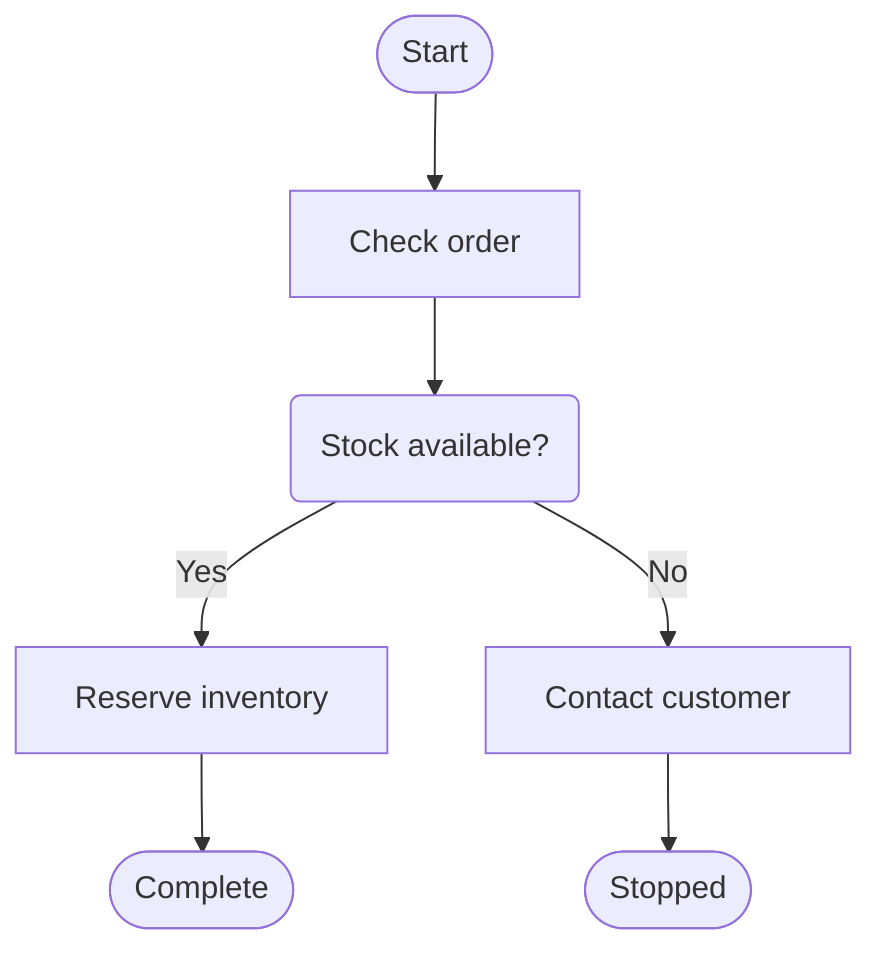

# @ketvietlab/design-system

Public server-rendered components for dense operational applications.

The package depends only on `@ketvietlab/ketjs-view`. It does not know about
KetSuite routes, translators, models, functions, sessions, or deployments.

```ts
// File: src/ui/orders.tsx
import {
  AppShell,
  Button,
  DataTable,
  ListChrome,
  ListPage,
  ModalSheet,
  Page,
  RecordPage,
  Section,
  Surface,
} from '@ketvietlab/design-system'
```

Load `@ketvietlab/design-system/styles.css` and put `data-kv-design-system` on the
application root. Components own their markup and `data-ui` hooks; applications
provide business data and translated labels.

### Scoped source build

Native consumers and the KetAtlas renderer can build this public package alone
from the repository root with `npm run build:design-system --prefix ketsuite`.
The scoped tsconfig compiles canonical component source; the existing atlas
runtime and CSS builders produce the package assets. The build stages its output
before replacing `dist`, so an unsuccessful compile keeps the prior package.
This command does not compile or test unrelated KetSuite deployments.

### Empty states and long content

`EmptyState` has one frame and one size in every context: a dashed placeholder panel
(`--kv-radius-lg`, surface fill, minimum height 15rem) holding a decorative illustration, the
title, the message and an optional next step. It is a placeholder, not a card, so it reads the same
on the canvas and inside a `Surface`; consumers do not wrap it in another frame or resize it. The
optional `visual` names why the region is empty through the illustration badge: `empty` (default,
nothing yet), `start` (first use, invite the first record), `search` (filters match nothing), `done`
(a cleared queue) and `locked` (the reader may not see the region). `icon` still replaces only the
badge glyph. A titled `DataTable` keeps its panel inset while empty and runs rows edge to edge once
there are rows. The backend kit's positional `emptyState(message, hint, { visual, actions })`
renders this component too, so older screens share the frame; its `icon` option is deprecated and
ignored. See `empty-visuals` in the catalogue.

`Thumbnail({ src, alt, size, fit })` renders square object/product media, with
token-owned rounded corners and 32/48/64px sizes (`small/default/large`). It uses
cover by default; `contain` preserves the whole image. A missing source reserves
the same geometry with an image glyph, never person initials. Supply an empty
`alt` beside text that already identifies the product; otherwise name the image.
A Thumbnail in `ContentCard.leading` keeps its own size (the slot's 2rem icon tile
does not apply to it); keep `Avatar` for people. Source URLs and image authorization
remain the consumer's concern.

A catalogue card whose picture identifies the item passes the Thumbnail as `media`
with `mediaPlacement: 'start'`. The picture is a 6rem square (5rem below 48rem) beside
all of the card's content instead of edge to edge above it (`top`, the default), and
`meta` becomes the item's key-figure row: it spans the content, sits at its end and
uses the main ink, so a price and a status line up across a row of cards. Put the
code and unit line in `summary`. Collect such cards in `CardGrid` so the column count
follows the width. See `attachments-media` in the catalogue.

A `ContentCard` with `href` is one target, like a table row with `rowHref`: its
title link covers the whole card, so pressing anywhere opens it, and the card wears
the focus outline while that link has keyboard focus. Any other link, button or
control inside the card stays pressable above the covering link. Use a pair of such
cards (`leading` icon, `title`, one-line `summary`) for ways into other screens
instead of a row of buttons; do not wrap a card in a second anchor.

`EmptyState` wraps complete titles and messages, including unbroken search terms, inside
its available width. Its grid column can shrink and text breaks where needed; consumers
do not clip the content or truncate the reader’s query. See `empty-long-content` in the catalogue.

### Stack and local scrolling

Peer sections on one surface use `Stack({ divided: true })`. The stack owns one
1px `--kv-panel-border` hairline and its gap on both sides. Flattening a child
Disclosure or Surface removes that child's frame, preserving the parent's divider,
including in flat presentation. See catalogue specimen `peer-section-dividers`.

A table's scroll region (`kt-scroll` of KetTable, `table-scroll` of DataTable) is the
boundary of its width: it contains its inline size (`contain: inline-size`), so the table
scrolls inside the region and never widens a parent Stack, a wrapping client island or the
page. `Stack` keeps an `auto` column and its children their default minimum, so a Stack
inside a table cell still reports its text as min-content and two-line cells never
collapse and overlap. Do not give the Stack a `minmax(0, 1fr)` track or shrink its
children, clip it, or add width overrides in consumers. See catalogue specimen
`stack-scroll-boundary`.

DataTable raises visible row controls above a row-link overlay. It leaves hidden
native controls in enhanced pickers in their own positioning context, so the
form proxy cannot create an extra line box or displace the visible trigger.

In the mobile stacked presentation, a cell containing a text input, select,
textarea or combobox uses a full-width row for its editable value. DataTable
owns the label/value row and immediate child sizing; Field owns input typography
and inside spacing. This also covers a Field composed inside Stack with a price
hint, whose intrinsic flex width otherwise reduced a purchase price input to
24px. Read-only cells and desktop table geometry retain their existing layout.

AppTopbar's location strip lets the context shrink before its navigation, search
and account controls. Context copy should use Text's `breakWord` for long names.

### Primitive harness

Run `npm run design:system` and open `/primitives` for a comparison surface of every
registered primitive. The catalogue rail links to it. `theme=light|dark|system`,
`density=compact|default|comfortable`, and `tab=overview|activity` are URL-backed;
theme and density changes retain the navigation specimen's active tab.

The seven families cover action hierarchy and sizes, loading/disabled states,
semantic tones, long labels and identifiers, field validation/access states,
native choices, route navigation, feedback, and progress boundaries. Use keyboard
Tab/Shift+Tab for focus, Space for checkboxes, arrow keys for radio/select controls,
and Enter for the breadcrumb disclosure and route links. Compare at 390px, 768px
and 1440px in both themes and all three densities. A text action and an icon action
of the same size must share a height; fields must align and content must stay inside
its sample at narrow widths. The harness deliberately leaves actions as specimens;
it does not simulate saving or creating records.

`PrimitiveHarness` and `primitiveSections` are available from the `/catalogue`
entry. Its `primitive-harness`, `primitive-section`, `primitive-section-head`,
`primitive-row`, `primitive-caption`, and `primitive-sample` hooks own only the
comparison layout. Component internals use the same production CSS as consumers.
Notices keep their icon beside the copy and move actions beneath it when the
notice itself is narrow. Action icons, spinners and tag remove links do not shrink;
long tags wrap and progress percentages remain intact.
Select keeps the native picker and keyboard behaviour. Its field-owned chevron
has a token-based inset, reserves space for long values, follows disabled colour,
and moves with the control when labels stack. Vertical option groups align their
label with the first option; checkbox/radio controls have no browser margin.

### Normalized primitive contract

Design rules and the numeric Polaris reference matrix are maintained in
[Két Design System](../../skills/ket-design-system/SKILL.md).
Install the agent skill with `npx @ketvietlab/ket-design-system-skill@latest`.
The component APIs and compatibility notes below describe the implementation.

| Family | Public component API | Verification |
| --- | --- | --- |
| Typography | Text: visual variant independent of semantic element, tone, weight and numeric treatment | Render + browser dimensions |
| Icon | Icon: shared Lucide names and informative/decorative semantics | Render + catalogue |
| Inline links | Link: native navigation, target and disabled treatment | Render |
| Actions | Button / LinkButton / IconButton: independent variant and tone, loading, pressed and width | Render + browser loading geometry |
| Action composition | ActionGroup: shared alignment and sibling spacing | Catalogue + CSS |
| Field shell | FieldFrame: label, help, error and associations | Render |
| Text inputs | TextField / Field: native value, validation, access and affixes | Render + browser |
| Search | SearchField: native search and optional clear control | Render + browser clear/focus/events |
| Numeric inputs | NumberField / MoneyField: numeric constraints, currency and precision | Render + browser dimensions |
| Multiline input | TextArea: rows, resize and native validation/access | Render + catalogue |
| Selection | Select: native choices, disabled state and label association | Render + browser |
| Choices | Checkbox / RadioGroup / CheckboxGroup / Switch: checked state separate from submitted value | Render + browser mixed/reset/submission |
| Status | Badge / CountBadge / Tag: tone, icons, progress and optional announcements/removal | Render + catalogue |
| Identity | Avatar / MediaLabel: optional image, fallback and text content | Render + browser image failure |
| Feedback | Notice / Tooltip: announcements, associations and shared interaction runtime | Render + browser keyboard/Escape |
| Progress | Progress / Spinner / Skeleton / LoadingState: determinate or loading semantics | Render + catalogue |

`Icon name="megaphone"` identifies advertising, including the Ads application rail entry. It uses the shared icon size, currentColor and accessibility contract.
The Lucide glyphs `layout-dashboard`, `target`, `users`, `wallet`, `route`, `radio-tower`, `sparkles`, `bot`,
`flask-conical`, `shield-check`, `sliders-horizontal`, `scale`, `plug`, `receipt`, `history`, `pause`, `play`, `undo-2`, `zap`,
`download`, `refresh-cw`, `credit-card` and `file-text` name
navigation destinations and commands in operational apps; `trending-up` and `trending-down` belong to
`Metric.change`. Copy new glyphs from Lucide with their 24px geometry rather than drawing look-alikes.

### Date pickers

Enhanced asset controls can compose `Field` with `control` and `layout="inline"`.
The public frame keeps the label beside the control at narrow widths, owns the
label/control gap and uses the control's real native ID. Keep thumbnail geometry
in the asset recipe; the Upload catalogue demonstrates the composition.

Open `/dates` for the focused Vietnamese playground (`states=1` expands validation/access examples), or the `date-time` specimen
under `/components/form-controls`. `DatePicker` keeps its native date input. `DateRangePicker` combines one read-only range display with a calendar icon inside the same frame as DatePicker. Two hidden boundaries retain the existing names and ISO values. The runtime enforces required, min/max and step; read-only, disabled, help and field errors remain supported. Submission stays `YYYY-MM-DD`.
`DateTimePicker` and `TimePicker` retain their native local-time controls.

Load `/runtime/auto.js` alongside the stylesheet, or call
`attachDesignSystemInteractions(root)` from `/runtime` and dispose its returned
cleanup when the root is removed. The runtime also enhances fields inserted later.
Without JavaScript or the native Popover API, DatePicker retains its native input; DateRangePicker displays and submits its saved boundaries but cannot edit them.

In CSR islands, DateRangePicker synchronizes its read-only display when the saved
boundary attributes change, including Back/Forward and refreshed results. This
does not emit another filter decision. Its shared runtime releases the observer
when the picker is removed or disposed.
Server views never read the clock or access the DOM.

```tsx
<DatePicker id="delivery" name="delivery" label="Ngày giao hàng" />
<DateRangePicker
  id="period" label="Thời gian báo cáo"
  start={{ id: 'from', name: 'from' }} startLabel="Từ ngày"
  end={{ id: 'to', name: 'to' }} endLabel="Đến ngày"
/>
```

The range calendar header select offers **Hôm nay**, **Hôm qua**, **7 ngày qua**, **Tháng này**,
**Tháng trước**, **30 ngày qua**, and **90 ngày qua**. Rolling ranges include today;
month presets cover the entire calendar month. `today="2026-09-30"` supplies a
business-timezone civil date; otherwise the browser reads local today on opening.
`presets={false}` hides quick ranges, or pass an ordered subset of `DateRangePreset`
IDs: `today`, `yesterday`, `last7`, `thisMonth`, `lastMonth`, `last30`, `last90`.
Presets outside either input's bounds or step are disabled, never silently clamped.

Click two dates to form an inclusive range; reverse selection is ordered. Both
calendars hold a draft until **Áp dụng** updates the fields and emits bubbling
`input` and `change` events. **Hủy**, Escape and outside dismissal discard that draft.
Choosing a preset commits immediately. Activating the range display opens the calendar. Invalid or incomplete required ranges show a field error and block form submission. Reset restores the original values.

Arrow keys move by day/week; Home/End move to week edges; PageUp/PageDown move by
month (Shift changes year). Enter/Space selects. Tab can leave the non-modal popup;
Escape, Cancel and Apply return focus to its opener. Range calendars show two months
on desktop. Below 768px, a vertical list renders twelve consecutive months around the
selection; scrolling preserves the draft and month navigation recenters that window. Both pickers become fullscreen modal dialogs on mobile,
with fixed commands, a scrolling month list, safe-area insets, contained focus,
and an inert, scroll-locked background. Desktop calendars remain anchored non-modal
popups. The native top-layer popup avoids ancestor clipping.
`locale="vi"` is the default (`en` is also supported); `weekStartsOn` accepts 0 or 1
(Monday by default). `calendarLabels` overrides commands, status and preset labels;
it does not change the browser's native date-input formatting.

The `date-picker` / `date-range` hooks own composition; `date-inputs`,
`date-control-row`, `date-tools`, `date-field-control`, `date-range-preset`, `date-boundary` and `date-range-error` own the control area. The shared Field supports `labelHidden`, `selectionHidden` (select chevron only, options remain readable) and `appearance="embedded"` for accessible compound controls.
`date-calendar`, `date-calendar-head`, `date-calendar-title`, `date-calendar-body`,
`date-calendar-months`, `date-month`, `date-month-title`, `date-grid`,
`date-weekday`, `date-cell`, `date-day`, `date-calendar-footer` and
`date-calendar-status` own the popup. `data-selected`, `data-in-range`,
`aria-current="date"` and native disabled states define calendar styling; consumers
compose the public components rather than targeting their descendants.

### Popups close on an outside click and on Escape

Every popup built on `<details>` behaves like the action menu: a click outside it
closes it, and Escape closes the open one and returns focus to its summary. This
covers `Menu` (`data-ui="menu"`), the period choice of `TimeframeFilter`
(`data-ui="timeframe-menu"`) and list view settings (`data-ui="view-settings"`).
The runtime lists the non-menu popups in `DISMISSIBLE_POPUPS`; a new popup component
adds its hook there instead of wiring its own document listener.
The outside click is heard on the document, so an island that follows a link in place
calls `preventDefault()` only: the shell's fragment navigation already leaves a
prevented click alone, and `stopPropagation()` would keep an open menu or filter
popover open after the click.

### Menus stay in view and name the choice they show

A menu panel opens from its trigger's start or end (`align`, `mobileAlign`). Where that
carries it past an edge of the viewport, as from a trigger in the middle of a phone row,
the runtime slides the open panel along the row until it is 8px inside, its leading edge
on a whole pixel; a panel the viewport holds stays where its trigger put it, and closing
forgets the move. The runtime hears every menu's `toggle` on its root as the event is
captured, so a menu an island draws after the runtime attached is placed too, and an open
panel is placed again when the viewport is resized. Consumers do not move panels with CSS.

`placement="right"` opens beside a side-rail trigger, aligned to its bottom edge;
shared runtime geometry keeps the panel inside its viewport and clipping parent.

A `trigger` replaces the label inside the summary, and the label still names the menu.
Where the trigger shows the choice in effect, as a filter or a period does, the label
names both, `Cơ sở: Holiday Inn`, as `DatePresetPicker` names its own: a name without the
choice the reader sees is one they cannot say to reach it (WCAG 2.5.3).

### Code blocks

`CodeBlock({ value, label, language?, wrap? })` shows literal text a reader copies
or inspects: a JSON payload, a response body, a shell command. It renders
`<pre data-ui="code-block"><code>` as a labelled, keyboard-focusable region
(`role="region"`, `aria-label`, `tabindex="0"`), so a long payload scrolls inside its
own frame and is reachable without a pointer. The block is bounded to 24 lines;
longer text scrolls vertically, and wide lines scroll horizontally unless `wrap`
(`data-wrap="true"`) folds them, which suits a command but not indented JSON.
`language` is recorded as `data-language` for consumers that announce or copy it;
the block does not highlight syntax. Type, frame and focus ring come from tokens
(`--kv-font-mono`, `--kv-text-xs`, `--kv-panel-border`, `--kv-color-surface-subtle`).
Specimen: `code-block` under Status.

### Collections are client islands

`ListChrome.filterMenus` composes native `Menu` choices and `DateRangePicker` with
`variant="filter"`. The slot caps its group to the available panel width, so the
controls wrap inside an opened phone disclosure. Do not put `FormGrid` here: it
is a Section form layout whose fractional tracks need a sized working region.
Measure individual controls and labels, including the opened phone disclosure;
document and table overflow checks alone do not catch collapsed filter controls.

Every full-page collection (`ListPage`/`ListScreen`) renders its filters, results and pager
as client islands over one paged read. A list grows from a week of records to ten years of
them; rendering every row on the server and re-rendering the page for each filter does not
stay fast, and the server cannot keep the reader's place while it does. A new list starts
this way; an existing server-rendered list moves to it when it is next changed.

- **Islands and store.** The list is three islands that share one store keyed by the
  collection: controls (`ListChrome`: search, filter menus, facets, sort, period), results
  (`KetTable` and the list states) and footer (pager). Their server view reads the query from
  the URL and renders the frame and a loading state only; the first client render is the same
  markup, so hydration adopts it. Views stay render-pure; the store owns fetching and history.
- **One paged read.** The browser asks one read function for one page of one query through
  the function transport (`POST /_ket/fn/<module>.<search function>`). Input is the
  normalised query: filters, `q`, `sort`, `page`, `pageSize` (at most 100). Output is
  `{ query, total, page, pages, rows, counts, isEmpty }`:
  - `query` is the input as the function applied it (unknown values fall back to defaults,
    the page is clamped), so the client corrects its URL rather than guessing;
  - `rows` carry ids and raw values (civil dates, minor-unit money with its currency); the
    client formats them;
  - `counts` feed the facets and filter menus in the same read; a group's counts ignore its
    own filter;
  - `isEmpty` tells "nothing recorded yet" from "nothing matches".
  The function enforces permissions and scope. The browser never loads the whole collection
  or reads per row.
  `ListChrome` owns wrapping inside its filter group at every width: controls move intact
  to the next line when the group exceeds the available canvas.
- **URL and history.** The query lives in the URL with defaults omitted. Filters, facets,
  menus, sort headers, period links and pager links are real `href`s that the island follows
  in place; each decision is a `pushState`. Search narrows as the reader types (debounced, about
  250ms); the first keystroke pushes and refinements replace, so Back returns to the list as it
  was before the search. `popstate` reads the URL and never writes. A value the function
  corrected (a page past the end) is written back with `replaceState`. Older spellings in old
  links are still read.
- **Saved records.** A record modal over the list announces a save with a cancelable
  `ket:records-changed`. The island reads its page again and calls `preventDefault()`, so the
  backend shell does not re-fetch the content slot behind it (see `record-modal.md`, Collection).
  The Back that closes the modal lands on the query already on screen (or already being read
  after the save) and reads nothing; Back onto a page that failed reads it again.
- **Network.** Each read aborts the previous one and a late answer is ignored. Recent queries
  are cached (about 20): Back shows its page at once and reads it again behind it. A read
  slower than about 150ms dims the rows on screen (`data-dimmed`, `aria-busy`) instead of
  swapping them for a skeleton; the skeleton is for the first load only and has the height of
  the real table, so nothing shifts when rows arrive.
  `KetTable`'s server form accepts `loading: { rows, lines? }` (1–100 rows), renders
  decorative placeholders and disabled selection, and never reads row cells or links
  before data arrives. `busy` dims retained rows using the table's own tokens.
  A client presenter may pass `selectionState: { ids, anchor?, onChange }` to keep
  selection across pure renders; the callback stays in the client and is never serialized.
  `BulkActions.clearLabel` resets its associated native form as well as issuing the
  `clear-selection` command. A collection clears page-local selection on each new answer.
  `ListChrome bulkPresentation="replace"` replaces the query toolbar while controlled
  selection is nonempty and restores its query controls when selection clears.
  Danger badges use `--kv-badge-danger-text`: the existing Két red in light mode and
  its lighter palette step in dark mode, keeping small status text above AA contrast
  on table and record surfaces without changing global danger colors.
  Badge owns its intrinsic inline size (`inline-size: fit-content`), so short labels stay
  compact in Grid/Stack and column Flex layouts. Long labels still wrap within the available width.
- **States.** Loading (skeleton); failed (`Notice` danger with a retry); offline (`Notice`
  warning with a retry, and a new read on the `online` event); permission denied; empty on
  first use (with the create action when the reader may create) versus empty after
  filtering (clear the filters, widen the period). After a failure counts are omitted, never
  left as a placeholder.
- **Accessibility.** Focus stays on the control that changed. `PagerBar` renders a step that
  reaches the first or last page as the same element, a disabled link (`role="link"`,
  `aria-disabled="true"`, `tabindex="-1"`, no `href`), so the focus on it outlasts the island's
  render instead of falling to the page. A polite live region announces
  the result range ("1–25 of 2,696") and nothing else; a failure notice announces itself and
  the live region does not repeat it. A sortable header's accessible name says what the link
  does ("Arrival, sort earliest first").
- **Table.** The results island renders `KetTable` in its server form (`columns[].cell`,
  `sortHref`/`sortLabel`, `responsive: 'stack'`) from the store. KetTable's `manager` mode
  suits a fixed input without counts or URL state; it is not the collection runtime.
- **Without JavaScript** the controls still navigate as links and forms, but rows need the
  island. This is accepted: the product requires JavaScript for islands.
- **Checks** for a list island: the read function's contract (defaults, clamping, counts,
  empty), server and first client render identical for several URLs, a history harness
  (push, replace, popstate writes nothing, clamp replaces) proven by mutation, and a slow read
  that dims instead of swapping.

The shared collection runtime is not public yet; until it is, a list implements this
contract in its own store, and the runtime extracted later must keep it.

### Opening a record from a collection

A row of a `DataTable`/`KetTable` (or `ResourceList`, `DataGrid`) and a `KanbanCard` open
their record in the presentation that fits the record, not in one fixed overlay. Choose it
once per record kind, and use the same choice for its rows, its cards and its create action.
A `KanbanCard` with `href` opens anywhere on the card, not only on its title: the title link
covers the card, any other control in the card (`actions`, a link in `meta`) stays pressable
above it, and a `draggable` card is still dragged as itself. Do not wrap a card in a link or
add a click listener to make it openable.


- **Record page** (`RecordPage`, or `WorkspacePage` for spatial work) when the record is a
  workspace of its own: several tabs or sections, money or line items, an activity log, work
  that outlasts a glance at the list, a URL people share, print or open from more than one
  place (a reservation, a stay, a folio, an order, a product template, a user).
- **Record modal** (`ModalSheet` over the collection) when the record is short and read or
  edited in the flow of a queue, and the reader goes straight back to the next row
  (a catalogue entry, a configuration item, a triage task).
- **Peek** (`Peek` in a `PeekLayout`, see below) only as a first step from a dense spatial
  view such as a tape chart, a timeline or a board: a summary, the two or three commands people
  take there, and the way to the record's page. A peek never replaces the page for editing
  the whole record.

Whichever presentation is chosen:

- The collection keeps its state. Its filters, sort, page and search live in the URL; a
  record page's way back is a header action carrying the reader's `returnTo`, and a modal or
  peek closes onto the same scroll position, selection and board column.
- A way back also keeps the reader's place: it names the row it left from. The row link's
  `returnTo` is the collection URL with `#row=<id>` (`rowAnchorHref`); on a plain click the
  collection calls `rememberRowAnchor(link)`, which writes the same fragment and the row's
  screen position into the current history entry. On arrival it calls `takeRowAnchor()`
  (scroll restoration waits while the rows load), renders with `KetTable`'s `currentRow`, and
  once the rows are on screen `restoreRowAnchor(root, anchor)` puts the row back where it stood
  through Back or the page's way back. `rememberRowAnchor` adds measured `top` and table
  `left` coordinates to a native record link's `returnTo` fragment; this needs no storage.
  An unmeasured shared link centres the row. Restoration focuses its link without
  scrolling again, unless focus is already inside that row (a modal returns focus to
  its opening action). It returns `false` when the row is no longer shown — the
  collection then says so instead of guessing. A new query clears the fragment.
- The record is a client-side island on the shared record runtime. It owns loading, focus,
  tabs, unsaved-change prompts and completion feedback; the server renders the closed modal
  host or the page in its loading state, so the server and first client render stay identical.
- Size follows content in a modal: a short record uses the default size, and only long
  content uses the large size with an internal scroll region.
- A record with more than one tab passes `height: 'fixed'` to `ModalSheet`: the dialog
  holds the viewport cap (`data-height="fixed"`) so switching between tabs of different
  heights never resizes it. `TabbedView` keeps the tab bar visible and only `TabPanel`
  scrolls. The panel deliberately owns no left or right padding; the containing modal
  supplies the horizontal inset. A
  single-view record and its nested dialogs keep `height: 'content'` (the default).
- Full-page tabbed content uses `TabbedView({ scroll: 'page', ... })`. Its panel
  grows with its content and wheel/touch scrolling reaches the containing page,
  including when the pointer is over the panel. The default `scroll: 'panel'`
  remains for bounded record modals; only that panel scrolls. A standalone
  `TabPanel` accepts the same option. Do not add consumer overflow overrides.
- A child action of the record (reassign, postpone, move a room, take a payment) opens as a
  nested dialog over the record, page or modal, not as another page.
- Do not open a workspace record in a modal to keep the list visible, and do not send a short
  catalogue entry to a page of its own.

### Settings directory

The rail's gear opens one settings page that gathers every module's configuration. Pass
`AppSwitcher.settings` as `{ id, label, href, current? }` to make the gear a link to that page
(`current` lights it on the page and on the configuration screens it leads to); the older
`{ id, label, items }` keeps the click-only menu for hosts that have no page yet.

The page is a `WorkspacePage` whose body is `SettingsDirectory`: sections, each a card holding
modules; a module shows its own menu mark (the host passes the icon markup its menu uses), its
name, an optional one-line description and links to its configuration screens. The host passes
only modules and links the viewer may open; a module without links and a section without
modules are not drawn. Up to three modules share a row, fewer as the card narrows. Link rows use
`--kv-control-height-large`, so they become touch targets on a phone without a local media rule.

`search` adds a search field. The shared runtime filters on input, accent- and case-insensitively
(`đ` matches `d`): a link that matches stays, a module whose name matches keeps all its links,
sections with nothing left hide, and the empty state appears only for a search that matches
nothing. Escape clears the field. Nothing is fetched: search narrows what the server already
permitted. Specimen `settings-directory`; tests `design-system-settings-directory.test.tsx`.

Configuration screens do not stay in a module's sidebar menu once they are reachable here.

KetSuite serves this page at `/admin/settings` and builds it from the permitted menu: each module
hangs a heading under the `admin` root (`admin.crm`, `admin.customerCare`, `admin.access`,
`admin.config`) with its own `icon`, and one entry per configuration screen beneath it. A screen
with tabs or groups lists each one by query (`?tab=process`); its first entry keeps the bare
path so the menu's prefix match still lights the gear there. `admin.access` and `admin.config`
form the organisation section, every other heading the business section. The runtime that
filters the page ships inside the committed client bundles, so rebuild them (`npm run build` in
`apps/ketsuite`) whenever this runtime changes.

Accent-coloured text (links, a module's mark) uses `--kv-accent-text`, not `--kv-accent`. In the
dark theme `--kv-accent` is a fill colour and reads at 3.4:1 as text on a panel; `--kv-accent-text`
takes a lighter step (about 8:1) and keeps the light theme's accent unchanged. `Link` uses it too.

### Peek beside a spatial view

`Peek` is a non-modal summary of one record docked beside the view it came from, inside a
`PeekLayout`. It is not a dialog and not a drawer: there is no backdrop, the view stays
interactive, and picking another item replaces the peek's content. Use it only where the reader
scans many items in place (a tape chart, a timeline, a board) and needs a first look before
choosing what to do; a list opens its records as a page or a modal instead.

```tsx
<PeekLayout
  peekId="reservation-peek"
  main={<RoomPlan />}          // invokers: aria-controls="reservation-peek", aria-current on the shown item
  peek={
    <Peek
      id="reservation-peek"
      eyebrow="R-1042"
      title="Alex Morgan"
      status={<Badge label="Due in" tone="warning" />}
      body={<DescriptionList label="Stay" columns={2} items={stay} />}
      actions={<ActionGroup label="Quick actions" actions={commands} />}
      record={{ label: 'Open reservation', href: reservationHref }}
      closeLabel="Close"
      closeHref="?view=all"                       // the peek lives in the URL
      previous={{ label: 'Previous arrival', href: '?view=all&peek=R-1041' }}
      next={{ label: 'Next arrival', href: null }} // end of the run: disabled, not a dead link
    />
  }
/>
```

- **Anatomy.** The head holds the eyebrow (code or kind), the title (`h2`, wraps rather than
  hiding the part that tells two records apart), the status badges and the tools: previous,
  next, the record (expand icon) and close. The tools keep the action target size; their
  glyphs use the small icon size so the title leads. The body is a summary only: description
  lists and short notes, never editable fields. The foot holds the commands for the record's
  state, on one row; it is omitted when there are none and while loading.
- **Commands** are two or three, at most one primary, and open the flow or nested dialog that
  does the work. The peek itself never saves.
- **The record** is always reachable, also while the summary loads or fails: the expand tool
  opens the record's page (or its modal), carrying the reader's way back.
- **URL.** The peeked record is a query parameter (by convention `peek=<id>`). Opening pushes
  a history entry, moving to another item (an invoker or the pager) replaces it, closing pushes;
  Back and Forward restore the peek without writing. Close is then a link to the URL without
  `peek`; without a URL it is a button.
- **Loading** shows the frame with the title the reader picked and a `Skeleton`, so the rail
  keeps its place; status and commands wait for the record. An error is a `Notice` with a retry
  in the body; a record that no longer exists is an answer (an informational notice), not an
  error. Cache recent summaries and read ahead on hover/focus of an invoker so opening is
  usually complete.
- **Layout.** From 64rem the peek is a rail of `--kv-right-rail-width` beside the view, one
  `--kv-layout-gap` away, sticky in the viewport. Below 64rem (a tablet beside the shell's
  sidebar, or a phone) it is a sheet over the lower part of the view, capped at
  `--kv-peek-sheet-max-height` (60dvh), and the view keeps that much scroll room under its last
  row. `mode="embedded"` lays it out in place, for documentation and catalogue specimens.
- **Focus and keys** (`attachPeekInteractions(layout)`, attach once per layout from the island
  that renders the peek): opening from an invoker moves focus to the panel; a page that loads
  with the peek open, or a peek restored by history, leaves focus alone. Another invoker
  replaces the content without moving focus; the heading is a polite live region, so the new
  record is announced. Escape closes through the close control unless a dialog or popup above
  owns it. When the reader closes the peek, focus returns to the item it showed (after paging,
  not the first invoker); when the application closes it, only if focus would otherwise be lost.
  Where the peek is a sheet, the invoker is scrolled out from under it.
- **Invokers** carry `aria-controls` naming `peekId`, and the shown item `aria-current="true"`.
  `PeekLayout` puts that id on the peek's place, which stays in the DOM while no peek is open,
  so the reference resolves in every state; the `Peek` inside takes the same `id` as the stem
  of its title and close ids and carries no id of its own.

### Option groups

`checkbox-group` and `radio` fields (`CheckboxGroup`, `RadioGroup`, or `RecordForm`
fields with those types) keep one label on the left and the options on the right
from tablet width up (above them below it, as every field does), each option's text
after its control. `optionsOrientation` sets how the options flow:

- `horizontal` (default): options wrap on one line. Use for a few short choices.
- `vertical`: one option per line, rendered as `data-orientation="vertical"` on
  `field-options`. Use when the choices should scan as a list, such as companies,
  branches or job roles.

Do not restyle `field-options` in an application to stack options; pass
`optionsOrientation: 'vertical'` instead.

### A short entry with its command

A single-line entry that is acted on by itself, such as adding a tag or applying a
code, passes the command as `action` (usually a `Button`). The field renders
`field-row` in its control column: the entry keeps a compact width (at most 20rem)
and the command follows it at the action gap, so it never drifts to the far edge of a
wide form. The label, help and error stay the field's own. The shared runtime makes
Enter in the entry run that command instead of the form's first submit button, and
skips it while an input method is composing. Without the runtime a submit `Button`
still submits the form, so the host must accept the entry on that submission too.

```tsx
<Field id="new-tag" name="newTag" label="New tag" maxLength={40}
  action={<Button label="Add" type="submit" variant="secondary" />} />
```

Use it for text entries only; a select or a choice group has no command beside it.

### Fields in the sections of a longer form

A form split into named sections (a check-in declaring each guest, a profile with
an address block) lays each section's fields with `FormGrid`, not a `Stack` of
fields or a generic `Grid`:

```tsx
<Section id="check-in-guest-2" title="Second guest" body={
  <FormGrid columns={3} items={[nameField, birthField, genderField, documentField, numberField, nationalityField]} />
} />
```

- `FormGrid` renders `form-fields` around the form grid and measures its own
  width. With `columns={3}` it lays three fields per row once that width is at
  least 52rem on desktop, which a default-size dialog's body reaches; narrower
  containers keep the two-column grid and a phone stacks them. A `default`
  dialog is wide enough: do not enlarge the dialog to get three columns.
- The grid owns the 16px row and 24px column gaps (`--kv-gap-form-row`,
  `--kv-gap-form-column`); each field keeps its label, help and error. A
  `span="full"` field such as a note keeps one cell's label width, so its label
  lines up with the first column. A field whose label is hidden (a `DropZone`
  names itself inside the zone) has no label track: its zone, help and error
  take the whole row.
- A cell is about a third of the dialog: keep labels, option labels and field
  messages short enough for it. Put an explanation once in the section's
  muted text or the form notice, not as help under every cell.
- Give each repeated section an `id`. `Section` then renders
  `aria-labelledby` from its title, so a screen reader distinguishes the
  second guest's "Full name" from the first's.
- `FormGrid` does not render a `<form>`; the enclosing form owns submission.
  `RecordForm.columns={3}` remains the choice for a single form without
  sections.

### Facts and the rail on a record page

A long record page reads its facts in `DescriptionList`s inside `Section`s and keeps
what blocks the record (unpaid balance, missing guarantee, unassigned room) in the
`aside` rail:

```tsx
<RecordPage
  title="Order SO-1042"
  aside={<Surface title="Needs attention" body={blockers} />}
  asideLabel="Needs attention"
  asideWhenStacked="before"
  body={<Section title="Delivery" body={<DescriptionList columns="auto" items={delivery} />} />}
/>
```

- `DescriptionList.columns="auto"` fits as many 12rem columns as the list's own
  width holds, at most four: three beside the rail on a 1440px screen, four on a
  wider one, two on a tablet, one on a phone. The empty tracks of a short list stay,
  so every list of the same width on the page shares its columns. Use it for the
  facts of a page and of a large record modal, whose groups stack at the dialog's
  full width (two fixed columns leave half of that row empty); a small or default
  dialog and a card keep a fixed `columns` count.
- `RecordPage.asideWhenStacked="before"` puts the rail first once the page stacks
  into one column, between the header and the record, in the document as well as
  on screen, so its commands come before the record's in keyboard order. A wide page
  still draws it in the rail column. The default `after` keeps the rail below the
  record; use `before` only for a rail of things to act on, not for reference
  facts.
- A rail entry that points at the card where it is fixed (a missing fact held per
  variant) links to that card's `Surface.id` as `#id`; every entry of one list is
  then the same compact tertiary `LinkButton`, so the list keeps one edge.

### Relation pickers

`RelationSelect` (`createRelationSelectView`/`relationSelect`) is a live client
island, unlike the rest of the package's progressively enhanced controls: it owns
its own state and calls `/_ket/fn/<name>` itself through `RelationSelectConfig.manager`
(`listFunction`, optional `saveFunction`/`removeFunction`). A consuming app mounts
it through its own island runtime (`defineIsland` in `@ketvietlab/ketjs-view`) and
supplies a JSON-serializable config; nothing about it depends on server-rendered
markup, so it may be cold-mounted anywhere the host places a matching island
element — including inside a view that is itself already client-rendered, such as
a modal a JavaScript runtime opened — not only hydrated from the page's initial HTML.

For a large catalogue, set `manager.searchInDropdown: true` to search the server
while typing in the inline dropdown (180ms debounce). Results use the manager's
label and description fields, with loading, error/retry and empty states. New
queries abort the previous read and late responses are ignored. Selected values
remain available to the native form. Omit this option for a local picker; the
manager's **More** dialog remains available in both modes.

A record a manager picker creates in its **More** dialog, renames there, or picks from
server results joins its options for the rest of the page, keyed by `listFunction`. A
record form re-mounts its islands from props written before that record existed; the
picker still shows the choice's label, its native select still holds the value it
posts, and every picker of that list offers the new record, without a reload.

A picker seeded with `options` and no `manager` is a local autocomplete: its
dropdown lists every match of the typed text (label and description), not the
first seven, and it shows no **More** footer, because without a manager there is
nothing to browse. Opening the trigger moves focus to the search field, so typing
filters straight away. A record form mounts every relation field (customer,
salesperson, warehouse, SKU) as this picker island rather than a plain `<select>`,
including the add row of an inline line editor.

Its option rows (`relation-option`, `relation-dialog-row`) show the current
selection as a trailing mark on the label's own line, never on a line of its own
below a description. The dialog's "more" action is a full-width row like the
options above it, not a chip-sized button; a consumer overriding the footer should
widen it to match, not narrow it to its label's content.

Its inline dropdown is not a `<details>`, so the shared outside-click delegator
does not own it. With native Popover support the island places its inline menu
in the browser top layer, preserving its DOM parent, native form and theme while
escaping Surface or modal clipping. The component owns a 4px anchor gap and 8px
viewport inset (`--kv-space-1`/`--kv-space-2`), start alignment including RTL,
above/below placement and bounded scrolling. Resize, ancestor scroll and visual
viewport changes reposition it; disposal removes listeners and closes the popup.
Without Popover support it retains its existing inline dropdown. Config, labels,
callbacks and form values are unchanged. Escape returns focus to the trigger;
moving focus outside or clicking outside closes the menu.
The shared outside-click delegator
(above) does not see it; the component closes it on an outside click itself,
same contract, different mechanism. Choosing a value also fires a real `change`
on the hidden native select (bubbling, a microtask after the choice settles) so
a host page's own `change`-driven wiring keeps working — a second field whose
options depend on this one's choice can key off it exactly as it would a plain
`<select>`. Rendering the picker itself through `each`, keyed on whatever the
dependency is, is what a host needs to swap it for a fresh instance when that
key changes: the component holds no `update()`, so a config change alone (a new
`manager.listInput`, a new options list) never reaches an already-mounted one.

The app structure is demonstrated with `AppNavigation` and four practical layouts inside `AppShell`:
collection (`ListPage`), record (`RecordPage`), flow workspace (`WorkspacePage`
with `layout="flow"`), and canvas workspace (`WorkspacePage` with
`layout="canvas"`). Compatibility adapters remain available for migrated
screens, but new catalogue examples should show one of those practical surfaces
inside the shell.

`AppNavigation` is the canonical dashboard menu. Supply one grouped item model and
place it in `AppShell.sidebar`; it is a persistent sidebar at 768px and above and a
mobile drawer below that breakpoint. The markup remains usable without JavaScript.
Items may contain recursive `children`; a parent expands its submenu directly below
the parent row, and an active descendant opens the complete path on first render.
Only leaf links expose the active state. By default, top-level branches form one
accordion and its open branch stays open until another branch is chosen. A group with
`exclusive: false` has independently collapsible branches, including keyboard activation.
Use `expanded` when a branch should start open without an active descendant.
An external `NavigationToggle.controls` must name the rendered drawer ID, which is
the navigation ID followed by `-drawer`; the shared runtime owns Escape and focus return.
Sizing, text roles and responsive rules live in the
[Két Design System navigation contract](../../skills/ket-design-system/references/visual-contract.md#application-navigation).
Labels and descriptions wrap; rows grow for long translations. Optional leading
content and counts reserve space only when supplied. Consumers do not override
navigation geometry or icon size.
KetSuite's `sidebarMain` and `sidebarNavigationContent` accept `counts`, a map of
authorized personal open-work totals keyed by menu node ID. Only positive safe integers
render through `NavigationItemData.count`; zero, missing and invalid values hide the badge.
Compute totals within the viewer's company and permissions before passing them to the shell.
List filters do not change these personal totals. Assignment and completion refresh the totals.
For branches with a leading icon, the 1px child guide is centred on the icon slot;
its offset is included in the child inset so parent and child labels stay aligned.
A reference-style menu, where branches are sections of one document rather than app
areas, sets `caret: true` on its `NavigationGroupData`: each branch without its own
`leading` content shows a chevron in the leading column (`data-caret="true"`), which
turns to point at the children while the branch is open. Give the group's leaf items a
`leading` icon so their labels align with the caret branches.
The optional interaction adapter adds mobile dialog semantics, Escape/backdrop/link
closing, focus trapping and restoration, background inertness, and scroll locking.

```tsx
// File: src/ui/workspace.tsx
<AppShell
  sidebar={
    <AppNavigation
      id="main-navigation"
      label="Main navigation"
      identity="KétSuite"
      context="Operations workspace"
      groups={[
        {
          id: 'sales',
          label: 'Sales',
          items: [
            { id: 'orders', label: 'Orders', href: '/orders', active: true, count: 7 },
            { id: 'customers', label: 'Customers', href: '/customers' },
            {
              id: 'reports',
              label: 'Reports',
              children: [
                { id: 'sales-report', label: 'Sales report', href: '/reports/sales' },
                { id: 'stock-report', label: 'Inventory report', href: '/reports/inventory' },
              ],
            },
          ],
        },
      ]}
    />
  }
  main={<ListPage title="Orders" body={orders} />}
/>
```

The catalogue is isolated behind `@ketvietlab/design-system/catalogue`, so the
production entry point does not load its specimen data or catalogue chrome.
Its registry connects every public component to an owner, maturity, supported
states and a rendered specimen. Component implementation and selector-bearing CSS
live below per-component-family directories; consumers still import only from the
package root.

Run the component catalogue from the repository root:

```bash
# Run from: ketjs/
npm run design:system
```

Then open `http://127.0.0.1:4100`.

Open `http://127.0.0.1:4100/inventory` for the documentation-style governance
registry. It lists current public exports, the KetSuite compatibility kit, and
the planned component catalog with ownership, maturity, Wave, evidence posture,
and promotion decisions. Filters are URL-owned and work without client JavaScript.

The registry reads `src/catalogue/inventory.generated.{ts,json}`, which `npm run build` and
`npm run check` derive from source. They are ignored by Git, so branches never conflict on them. Check
that every export has a policy entry, and the governance contract, with:

```bash
# Run from: ketsuite/
npm run design:inventory:check
npm run design:governance:check
```

### Operational demo

Run the same app on a separate port to inspect a connected sales workflow:

```bash
# Run from: ketjs/
PORT=4000 npm run design:system
```

Open `http://127.0.0.1:4000/demo`. The Vietnamese demo includes a flow overview,
searchable and paginated order collection, inline record forms, activity and
document tabs, a delivery board, creation sheet and state confirmation dialog.
It consumes public design-system components directly. App-owned behavior includes
selection, native form submission, validation, modal focus management and CSV export.
Synthetic orders live in the server process only and reset when it restarts;
the demo has no connection to production records, email or delivery services.

Every `AppShell` requires an `applications` configuration and renders one
`AppSwitcher` before the primary sidebar. Hosts provide the translated navigation
label, new-tab label, optional screen-help label, optional `settings: { id, label, items }` or `settings: { id, label, href, current? }` (see Settings directory), active app ID, and `{ id, label, icon, href?, unavailableLabel? }` items. Omit a destination for a coming-soon or unavailable app: the icon stays focusable for its name/status, with `aria-disabled` and no link action. The public
component owns the 48px graphite rail, 18px Lucide icons, hover/focus names, active
indicator and native `target="_blank"` links with `noopener noreferrer`. Desktop
items are 36px; mobile items have a 44px touch target. On mobile the rail is hidden
until the application menu opens; the shared runtime moves the same SSR node into
the drawer, keeping it within the dialog's Tab loop, and restores it for desktop
or cleanup. No rail markup belongs in navigation fragments.

Suite apps pass `applications.brand` for the symbol at the top of the rail and
`applications.navigation: { controls, label, tools }` for its sidebar opener.
`AppBrand.variant="mark"` crops the symbol from the start of a three-to-one lockup;
it does not widen the rail. The graphite rail uses the dark brand asset in either theme.
`AppNavigation.tools` supplies translated search label/placeholder, empty state and
collapse label. Its 44px header names the current app (Sales/Kinh doanh, Website),
has no divider, and stays outside the scrolling menu. Search opens on click, filters
the existing permitted menu including ancestor labels, ignores accents/case, opens
matching branches and restores their prior state when cleared. Escape closes search
before a mobile drawer. Global search remains a separate record/menu launcher.
Desktop collapse hides only the main sidebar and gives its width back to content;
the rail retains a focusable opener. Its state and search draft survive fragment
navigation. Mobile keeps the normal modal drawer and 44px controls; collapse is hidden.
The disposable shared runtime owns filtering, mutation observation, inert and focus;
consumers supply data/labels instead of rebuilding controls or CSS.
The footer renders a question-mark button only when `helpLabel` is supplied. Activating
it emits the bubbling, cancelable `ket:screen-help-request` event with
`detail.trigger`. This is a screen-owned guide hook only; the shell does not yet
supply guide content. A screen can render one `HelpDrawer` inside its changing content slot;
the shared runtime resolves the current drawer when opened, including after navigation or record updates replace that slot.
the shared runtime connects the persistent shell button to that guide. Below it, the settings gear uses
the shared `Menu` with `placement="right"`, aligned to the trigger bottom and
clamped inside the viewport/drawer. It opens on click/touch or keyboard, never
on hover. Escape dismisses the menu before the mobile navigation drawer; outside
click and selection dismiss it too. Hosts supply translated settings entries.

KetSuite's production `suiteApplications` projects the deployment's permission-filtered menu into Kinh doanh/Sales and Website destinations, plus disabled Accounting, Flow, Phone and Chat entries. Backend frames and Website Studio share the same registry. Accounting and the duplicate Website destination leave the main menu; Website stays in the rail. Administration moves to the rail's click-only settings menu, retaining permitted links. Help is omitted until screen guides are ready. The browser-safe adapter is also exported from `@ketvietlab/ketsuite/ui/application-switcher`.

The catalogue's `placeholderApplications` supplies Sales, Stay, Website, Flow and
Accounting examples; hash destinations are placeholders, not a deployment URL
policy. Backend hosts can replace them through `Frame.applications`. `/demo2`
uses `?app=` destinations so opening a new tab demonstrates the selected app.

Commerce Atlas uses the backend frame-slot contract. Its `AppShell.location`
contains `AppTopbar` inside `backend.global-topbar`, so record/source navigation
refreshes the current collection search action and identity along with content.
Keep the shell and sidebar owners in place; do not patch the topbar's private
links from the product runtime. This differs from `/demo2`'s content-only slots
and client-owned navigation state below.

`/demo2` keeps the same workflow with 18 application modules and the current
KetSuite shell: a symbol `AppBrand` on the graphite rail, current-app navigation header, organisation context and
global search/theme/account tools in `AppShell.location`, and no page breadcrumbs.
Global search finds navigation destinations and sample orders; its native GET
fallback preserves the selected appearance. Sidebar links, filters and nested
selection remain URL-owned. `/demo` retains its original composition.
The first request server-renders the complete shell. KetJS navigation requests use
`navigablePage` and return only `demo.content`, `demo.overlay` and a hidden
`demo.navigation-state` slot; the topbar and sidebar are never fragment targets.
The client updates active navigation attributes and opens the active branch in
place, with disposable page interactions and relation-island hydration after each
swap. Native links and GET forms remain the fallback when JavaScript is unavailable.


The demo supports grouped and flat presentations. Visual hierarchy, spacing and
surface rules are defined only by the skill; API behavior is documented below.

The public entry exports actions, status and feedback objects, fields, navigation,
`Tab`, `Tabs`, `TabPanel` and `TabbedView`, progress, layout primitives, the responsive application navigation, the
three-region app shell, page/record layouts,
`ListChrome` with `BulkActions` and `PagerBar`, the canonical list and record page
compositions, data tables, forms, and modal sheets. Use `ListPage` for operational
collections: applications provide translated identity, URL-driven controls and
result content while the pattern keeps header, controls, status, body and footer in
one stable order. `DataTable` covers the common collection contract: responsive
stacking, row selection, sorting, grouping, visible columns and row links. Do not
place record action buttons inside table rows; link the row to the record instead.
The exception is a document's own line table (the lines of an order inside its
record), where each row may carry its edit/remove actions. Those actions stay on one
line at 48rem and wider, so every row keeps one height and a tight table scrolls
instead of stacking a row's buttons; stacked phone rows still wrap them. Give short
values a `kind` (`number`, `currency`, `identifier`, ...) so a tight table never
breaks an amount or a unit between its characters.
A table needs exactly one name: `title` frames it in a titled Surface, `caption`
shows a caption above the rows, and `label` names it for assistive technology only,
for a table whose Section or Surface heading already says what it is. Do not repeat
that heading as a caption.
A titled table may add `description`, one line under the title that its Surface
renders (for example how the rows relate); the table itself stays unframed. Without
`title` the description is not shown.
Use `RecordPage` for durable subjects, and the compatibility `FormPage` only for
existing create/edit screens that have not migrated. Form fields support native
controls, custom controls, checkbox/radio groups and nested field groups. Route-owned
`ModalSheet` instances carry close/backdrop metadata and become fullscreen at the
mobile breakpoint. When one opens, the runtime focuses its first `aria-invalid="true"`
control (a step returned from a rejected submit), else its first control, else the dialog.
`RecordPage` moves its commands below the record's identity when the page itself is narrower
than 48rem, measured on the page container so a sidebar beside it counts: title, status, meta
and path read as one block, then the commands follow 12px away (header gap plus the commands'
own separation). The shared page band (`WorkspacePage` and its `DashboardPage`/`BoardPage` forms, `ListPage`
and the shell page header) does the same on a phone (below 42rem): its heading unwraps so the meta row joins the title
block, the band owns a 4px identity gap and the commands come last with 8px of their own, as on
`ListPage`; the compatibility `FormPage` follows the RecordPage order on a phone. A status or
description therefore never reads as a caption of the buttons. Phone rules use
`max-width: 47.9375rem` (or `width < 48rem`); `max-width: 48rem` also matches the 768px
desktop layout and is not used. The catalogue includes common component states; the page preview
also covers loading, empty, error, validation and read-only states in English and Vietnamese.

`KetTableColumn.wrap` opts a descriptive column into wrapping within the shared
text-width token; rows grow with content. It works in server and island tables.
Identifiers and numeric columns keep the default single-line behavior.
With `layout: 'fixed'` a single-line cell that runs out of room ends in an ellipsis rather
than painting over the next column; the full text stays in the DOM. A cell that stacks lines
in a `Stack` (a name over its detail) ends each line in its own ellipsis. A link or button placed
directly in the cell is bounded and truncated itself and draws its focus ring inset, so the
clip never hides focus. Cells holding a `Menu` or popover stay unclipped, the row link's
overlay belongs to the row, and stacked rows wrap instead. Give long subjects `wrap: true`.

`rowHref` provides one keyboard link per row, including the full row pointer target.
The link wraps the first column's cell and takes its text as its name, so the first column
names the row's subject (a title, a person), never a sequence number or a due date.
A row checkbox is named "{selectRow}: {row}". An island table takes the row from the first
column's plain value; a server table renders its cells, so it passes `rowName(row)` (the
same subject the first column shows). Without either, the checkbox falls back to the row id.
`currentRow` names the row the reader came back to from its record page: the row gets
`data-current="true"` and its link `aria-current="true"`, drawn as a 2px accent bar on the
row's start edge (its first cell; the whole stacked row on a phone), so it reads apart from
selection and hover and keeps the row's fill.
A stacked row (`responsive: 'stack'`, below 48rem) leaves `priority: 'tertiary'` columns to
its record, so a phone row stays a short summary; the cell carrying the row link is always
kept. Header and cell alignment use `start`/`end`, so `align: 'end'` numbers and the
current-row bar follow `dir="rtl"`; component stylesheets never set `text-align: left|right`.
Linked cells are display-only. Associate `selection.form` and `bulk.form` with the
same native form to submit selected IDs and the bulk command. Selection syncing
and select-all remain application runtime responsibilities.

From tablet width (48rem) up, a form keeps each label on the left of its control,
with help and errors below the control. Below tablet width, and in any column
narrower than 28rem such as a side panel, each label sits above its control.
Fields in a two-column `Grid` or a default `FormGrid` get half of the row each, so
while that grid is narrower than 56.75rem (two 28rem columns and the gap) each field
takes a whole row instead and keeps its label beside the control; this covers
tablet, small laptop and a page column beside an aside (see the skill visual
contract). `FormGrid` `columns={3}` keeps its own breakpoints. A lone checkbox keeps its label beside the box. Native inputs support `readOnly`,
`min` and `max`; choices can be disabled individually, and invalid nested groups
open automatically. Give repeated search/sort controls unique IDs. Loading links
are disabled, and empty query rows do not occupy space.

Route-modal and mobile-navigation focus trapping, background inertness, Escape,
focus restoration, scroll locking, and anchored positioning are provided by the
optional `attachDesignSystemInteractions` adapter. Route state, unsaved-change
decisions and submit outcomes remain application
responsibilities. Menu, popover, tooltip, dialog, toast, spinner and skeleton renderers
retain native links/forms and useful no-script behavior. See the backend development
guide for the full composition and integration contract.

A toast also reports work that runs in the background (an import) while it runs:
`Toast.progress: { value, label }` draws a small `Progress` across the toast, below its
copy and actions. The bar and its label (`180 of 450 rows`) sit in `aria-live="off"`, so
polling updates are not read out; put what a reader must hear in `title` and `message`
(started, finished, failed) and keep counters out of them. One `ToastRegion` per page owns
the bottom corner; the application polls and keeps the region mounted while empty so the
first toast is announced. While a modal dialog is open the runtime makes the page under it
`inert`, and a region inside that inert page drops under the dialog layer: a lasting toast
never covers the dialog's actions, and it returns to the top when the dialog closes.
One action (View) sits beside the copy; two or more (View, Dismiss) take their own row
under it, so the title and message keep the toast's width.
Specimen: `feedback-runtime`.

The shared adapter handles keyboard navigation only inside its attached root and
respects keys already handled by an inner layer. Disposing an ordinary island
does not move focus or release another overlay's inert lock. Modal Tab loops include
native menu summaries and skip negative tab stops, disabled controls, inert/hidden
content and the body of closed disclosures, even when the browser retains their
layout rectangles.

Typed form exports cover scalar and selection fields, controlled combobox/tag pickers,
civil date and local-time values, native file inputs, and a generic relation renderer.
Applications retain validation, query, permission, timezone, upload, and persistence
ownership; renderers preserve submitted text and expose native fallbacks.
`Combobox` names its toggle with `openLabel`/`closeLabel` and its list's loading and empty
states with `loadingLabel`/`noResultsLabel`; the defaults are English, so a page in another
language passes all four.

Data-operation exports compose URL-owned search/filter/sort/view state, one-link
resource rows, bounded grids, hierarchy, and inline native forms. The package renders
state and carries version tokens; application adapters own persistence, conflicts,
permissions, cross-page selection, and dataset queries.

Record composition exports cover facts, people, formatted values, one identity summary,
one neutral rail, activity/audit, attachments, and media. Applications pass authorized,
redacted results and retain storage and mutation ownership. Catalogue recipes vary slots
within `ListPage`, `RecordPage`, and `WorkspacePage`; they do not add a fourth page pattern.
`RecordRail` owns the separation of its sections: one `--kv-layout-gap` and a divider
between them, as a divided `Stack`. Pass sections to it rather than wrapping them in a
`Stack` or adding margins.

`StagePath` shows where one record stands in its process, like Salesforce's Path or
an ERP's status bar: each step is `complete`, `current` or `upcoming`, and a closing step
that is current takes the outcome's `tone` (`positive` won, `danger` lost). It carries no
counts or percentages; `Pipeline` is for how many records sit in each stage. The current
step has `aria-current="step"`, a passed step reads `completeLabel` after its name as
well as showing a check, and the step's `href` (for example, a move dialog) is a link on
every step except the current one. Names wrap rather than truncate; once the path is
narrower than 48rem, every step but the current one folds to its check or number. Pass it
as `RecordPage` `path`: the header's last row, so the header owns its spacing. `controller`
stays for a working editor below the header.

Before release, run `npm run design:release:check` from the repository root. It
requires zero planned components, current migration/rollback notes, and locked
deprecation admission. Publishing remains a post-merge operation from `master`.

Button/input dimensions are pinned to Polaris React 13.9.5: default buttons map to large (32px desktop / 36px mobile), matching inputs. Compact is 28/32px. Density does not resize controls. See [the dimension matrix](../../skills/ket-design-system/references/visual-contract.md) and run `npm run test:design-system:browser` to enforce measured geometry.

## Expanded SearchFilter

`SearchFilterConfig.presentation?: 'compact' | 'expanded'` is an additive presentation contract. Omit it to preserve the existing compact desktop popups and combined mobile sheet. With `presentation: 'expanded'`, labelled preset values remain visible in a second toolbar row. Search, grouping and saved searches lead the first row; the custom-rule editor mounts only when its add-condition control is opened. Grouping and saved searches have independently anchored disclosures at every viewport. Only custom rules and field searches render chips; preset/group/favorite state stays in its own control. `SearchFilterLabels.allValues?` and `noGrouping?` translate unselected values; `customFilterToggle?` optionally names the editor launcher separately from the existing add action. The grouping trigger shows the applied fields in order. `SearchFilterOption.groupLabel?` names an expanded preset group; existing IDs, OR-within-group semantics, facets, managers and navigation callbacks are unchanged. Clearing filters still preserves grouping.

An expanded filter section's panel is as wide as its longest value, at least its trigger and 12rem and at most 26rem, so a one-value section does not open a wide empty popup. Grouping and saved-search panels keep the 26rem their forms need.

`SearchFilterConfig.applyOnInput?: boolean` makes the typed text apply after a 250 ms pause, and at once on Enter, through the same `apply` payload (`query`). The text stays in the field, no generic query chip or suggestion list is created, and a pending pause apply is cancelled by Enter or disposal. Presets and grouping already apply as they are chosen, so a collection using this option has no separate apply step. Omitting it keeps the suggestion-then-chip behaviour.

`RecordFormProps.applyOnInput?: boolean` gives a GET filter form the same behaviour outside SearchFilter. The form carries `data-apply="input"`; the runtime (`attachDesignSystemInteractions`) submits it with `requestSubmit()` when a select, checkbox or radio changes, and 400 ms after the last keystroke in a text, search or number field. The blur `change` of a typed field is not a second submit, and an Enter submit cancels the pending pause. The visible submit button is replaced by a hidden default button, so Enter applies without JavaScript too; `form-actions` renders only when `cancelHref` is set. The typed field keeps focus across the submit, caret at the end: after a reload the runtime restores it from a `sessionStorage` entry (kept for 10 s, read once); when an island redraws the form in place, focus moves to the redrawn field with the same id, unless the reader has already left the field.

The `search-filter-expanded` catalogue specimen exercises the opt-in layout. Consumers should select the presentation through this public configuration rather than restyling private descendants. Density (`size`) remains independent of presentation.

A collection with an existing data controller may compose `createSearchFilterView(props, { apply(input, signal) })`. This optional integration receives the same query, facet, filter, ordered grouping and favorite payload as the RPC manager; it leaves data reads, history and pagination with the collection. The one-argument factory and serialized `searchFilter` island keep their manager behavior. Compose the controller's `view`, mount it at its own root and dispose it with the owner. Its standard `update({ id, config })` synchronizes query/facets/rules/favorites after Back or an external read while retaining unsubmitted text when the applied query did not change. Labels, presentation, capabilities and field/group vocabulary are fixed for that instance; remount when that structural configuration changes. Expanded selection returns keyboard focus to its own menu trigger.

A collection's data-backed choices (its vendors, its locations, its saved favorites) may arrive with its read's answer rather than with the page the server rendered. `controller.update(nextProps)` with new `config.filters` redraws the filter menus in place: a group that arrives later gets its own menu, the typed query, chips and open state stay. The book passes those choices on every answer; it does not rebuild the view to add them. Test: `search filter: choices that arrive with a later answer get their own menu`.

A list that also switches views (table/cards) or links to its saved filter puts the search filter in `ListChrome.query` rather than stacking a second toolbar row under it. The slot leads the query row at the search filter's own width (up to 48rem); `views`, `sort` and `actions` end that row level with the search bar (`data-query="slot"`, top-aligned because the expanded filter is two rows tall) and move under it as one group where the row runs out. `query` replaces the plain `search` form; lists without it are unchanged. Specimen: `search-filter-list-chrome`.

### CSR accounting consumers

`AppTopbar.search.mode="link"` leads directly to a search workspace and emits no
native dialog/template/noscript subtree; `dialog` remains the default. `ListPage`
accepts `busy` and `dimmed`: an island owns delay, stale reads and disposal; the
pattern owns `aria-busy` and `--kv-opacity-pending`. `Peek.closeControl` accepts a
public client trigger while keeping the summary non-modal. `ConfirmDialog` accepts
`mode="client"`; its cancel command is handled by the client modal owner.

Client-read record pages own `tab`, `dialog` and `dialogId` in browser history and
retain their list trail. Record commands retain an idempotency intent across an
uncertain response; changed input receives another intent, and success clears it.
`recordChanged` exposes captured parent edits to a child decision; a posting
confirmation must require saving those edits first. Runtime effects remain in the
island. Static SSR shell props never carry business data, rights or field options.
Peer Sections inside one Surface or modal use `Stack({ divided: true })`; its
existing token hairline is mandatory, including in CSR presenters.

### Exact values in adaptive metric cards

Use `CardGrid` with `minimum="wide"` for long currency metrics. Metric owns a bounded text column and wraps long labels and exact values; consumers do not truncate financial totals or override metric descendants. Specimen: `metric-exact-long-value`; focused producer checks and mutations: `design/account/producer-contracts.test.mjs` and `tools/design/verify-account-producer-mutations.mjs`.

A metric that opens what it counts (a queue, a filtered collection) passes `href`: the whole card is that link, focusable and named by its label and value. Do not add a separate "View list" button under the number. Inside a titled `Surface` a group of metrics is plain figures without `href`, so one card never holds several competing links.

### Change against a period and series over time

`Metric.change` (`{ label, direction: 'up' | 'down' | 'flat', tone? }`) compares the figure with an earlier
period. The label carries the signed amount and the period in words ("+12.4% vs previous 7 days"); a
Lucide `trending-up`/`trending-down`/`minus` arrow repeats the direction and `tone` says whether that
direction is good, so a cost that rose is `danger` with an upward arrow. The figure keeps the page's ink.

`ColumnChart` shows one magnitude over ordered periods (spend per day, orders per week). Each column is a
list item whose reading (`label · value(point)`) is real text; pointer hover shows it above the plot and the
bars, ticks and gridlines are decorative. Points carry optional `segments` with `keys`, exactly as a stacked
`BarChart`. `reference` draws one dashed level (a daily budget, a target) with a printed label and raises
the default top to include it. `labelEvery` prints every n-th period label, counted back from the latest
one; `tick` supplies short axis text. The scale starts at zero; negative values draw as zero. The plot is
11rem high with a 3.5rem axis gutter, and columns tighten their gap below a 32rem chart width. Specimen:
`column-chart`.

### Sidebar island slot height

AppShell gives its sidebar's only child the available block size, including a disposable island wrapper. Navigation keeps its viewport geometry and internal scrolling; consumers do not patch sidebar descendants. Producer CSS check/mutation and Account browser geometry cover this contract. Account's breadcrumb-free canvas is an explicit user choice and still exposes a separate list-return link.

Record runtime exposes `draftScope` (`record` / `dialog`) to namespace input IDs by owning layer. Route dialog metadata is present on both layers and must not determine control IDs. A refused submit focuses the first invalid control after rendering the retained draft.

`Button` and `LinkButton` accept optional `truncateLabel` for single-line record
values inside constrained layouts. The Action owns the shrink boundary and a
full-label tooltip; its public Text owns the ellipsis. Keep the nested Text when
updating the label at runtime, and update the tooltip to the complete value.
Default actions continue to wrap. See the long-label catalogue specimen and
`test/design-system-action-truncate.test.tsx`.

`Button.logo={{src}}` opts into a named brand choice. It replaces the visible
label with an 80×24 contained image on a 112×48 minimum stage, keeps `label` as
the accessible name/tooltip, and shows a Lucide check when `pressed`. Consumers
own selection and ordering; the public component owns geometry, frame, focus
and original brand colours on white in both themes. Ordinary controls are unchanged.
See `test/design-system-logo-button.test.ts` and the Button specimen.

`ModalSheet.size="workspace"` fills the available viewport width inside the
desktop overlay margin. It preserves the existing fullscreen phone behavior,
native close route, focus return and `height="fixed"` bands. Layer clipping
prevents focus/fragment navigation from scrolling the title or footer away;
the body retains its scroll. See `test/design-system-workspace-modal.test.ts`.

`Menu` label entries expose a stable `${menuId}-${entryId}-label` ID and optional
`hidden` state. A filtered menu can toggle its empty message inside the owned
panel without moving unrelated page content into the popup. The consumer owns
search results and live announcements; the Menu owns the label's spacing and
typography. See `test/design-system-menu-label.test.tsx`.

Menu choices and headings wrap long words within the panel. The shared runtime
measures the trigger and enclosing scroll regions, keeps the popup inside their
visible bounds, and opens above when more room is available. Resize updates the
measurement; closing/disposal clears it. The native disclosure remains available
without JavaScript. See `test/design-system-menu-fit.test.ts`.

Keyboard navigation skips hidden and disabled Menu choices after filtering.
A disabled trigger blocks activation and navigation keys while preserving Tab
and Escape. See `test/design-system-menu-keyboard.test.ts`.


### Screen help and ecosystem Mermaid

`Field({ type: 'date' | 'datetime-local', locale: 'vi' | 'en' })` forwards the
host locale to the public picker, including fields passed through RecordModalForm.
Omitting locale retains the existing Vietnamese picker default; native ISO values
and input names remain unchanged. See the English host Field in DatePickerExamples.

When a trigger belongs to a ModalSheet, RecordPage or Peek, help resolves the
guide inside that nearest content owner. A background screen's previously bound
guide must not override the record guide. Shell triggers retain their screen
guide; content-slot navigation resolves replacement guides at request time.

`AppSwitcherHelp({ label })` exports the rail's Help trigger for standalone app
navigation. Pair it with a screen-owned `HelpDrawer`; the existing runtime owns
`ket:screen-help-request`, association, Escape and focus return. It reuses the
same hook and geometry as `AppSwitcher.helpLabel`, without adding a second rail.

In the Suite shell a List or Workspace page puts no Help trigger in its header: the rail's
`AppSwitcher.helpLabel` is that screen's trigger, passed only when the screen has a guide, and the
header keeps the screen's own commands (none when it has none, rather than an empty `ActionGroup`).
RecordPage, ModalSheet and Peek may carry their own trigger, whose guide resolves inside them.
One without a guide of its own opens the screen guide that the content slot renders beside it, so
a page-level `?` still works on a phone, where the rail's `?` is out of reach.

For shell ownership, persistent navigation and host integration, read the
[shell integration guide for agents](../../skills/ket-design-system/references/shell.md).

Agents working on any screen must check its guide. If it is missing, author and
integrate a real Vietnamese/English Markdown guide in the same task and PR; update
existing guides when workflows change. A touched screen is not complete while its
guide is missing. Explain implemented tasks, states and relevant recovery; use
Mermaid when it clarifies a workflow, with the ecosystem theme below.
Render the screen-owned drawer in the changing content slot and enable the
shell's `AppSwitcher.helpLabel` only when that screen's guide works. The shared
`ket:screen-help-request` hook binds it; do not build a separate drawer or listener.
See `apps/design-system/help.tsx` for the composition. Verify open/close, Escape,
focus return, Markdown/diagrams and guide replacement on navigation in the current
deployment at desktop/mobile widths. This rule does not require migrating untouched
screens as part of an unrelated task.

`HelpDrawer` is the standard screen guide: 512px (`--kv-help-width: 32rem`) at the
right edge on desktop, modeless so the current screen remains interactive. Below
768px it uses a native modal dialog at full viewport width/height; navigation
closes first, body scrolling locks, native dialog focus containment applies and
closing returns focus to the navigation toggle. Desktop closing returns focus to
`?`. Escape, the close control and pressing `?` again dismiss it, and so does a
primary press anywhere outside the guide on desktop; that light dismissal leaves
focus where the pointer put it. A text selection dragged out of the guide and
keyboard activation elsewhere do not dismiss it. The header stays
fixed while only the body scrolls. Fragment navigation disposes the old guide and
binds the new screen content; the SSR shell is not replaced.

Hosts supply the translated `id`, `label`, screen `title`, `closeLabel` and `body`.
A page-owned public Button/IconButton can also launch the same guide with
`name="screen-help"`, the guide ID as `value` and `controls`, and `expanded={false}`.
The disposable runtime binds it alongside the application-rail trigger; native
Help owns Escape without dismissing an underlying route modal.
Use `MarkdownContent` for the body, with `source`, a host-supplied GFM lexer
(`marked.lexer` is compatible), localized diagram/source/loading/error/table labels
and `headingOffset={1}` for the drawer's heading hierarchy. The component renders
headings, paragraphs, emphasis, lists, tasks, links, images, quotes, tables and code
on the server. Raw HTML is text, executable/protocol-relative URLs are rejected,
and Mermaid fences retain readable source without JavaScript. Tables and wide
SVG diagrams scroll within their own regions instead of widening the drawer.
Mermaid renders off-screen; once a diagram is shown the runtime fits its view box
to the drawing in place (8px inset), so a box measured off-screen never shifts or
clips it. A narrow drawer reads a top-down flow (`flowchart TD`) without scrolling.

Mermaid presentation belongs to the public DS runtime, including uses outside
help drawers. `createMermaidTheme` and `readMermaidPalette` are exported from
`@ketvietlab/design-system/runtime`; every app must use this configuration rather
than creating a local theme. It resolves the current DS tokens to hex colors,
including alpha and light/dark aliases, uses Inter 13px, 1.25px flow/sequence strokes,
12px rectangular node corners and rounded connectors. Process nodes use the accent
surface; connectors stay muted. Explicit accent/positive/warning/danger classes
(`kv-accent`, `kv-positive`, `kv-warning`, `kv-danger`) work on rectangles,
polygons, circles and path-based shapes such as start/end stadiums. Notes use the warning surface. Flowchart, sequence, state, ER,
class, pie, Gantt and graph palettes share these roles; chart categories use soft
DS fills and readable foregrounds, never Mermaid's default rainbow.

Flowcharts use 24px sibling spacing, 32px rank spacing, 12px padding, an 180px
label wrapping width and an 80px minimum label width. These are diagram geometry,
not app spacing overrides. Labels stay 13px at narrow widths; scroll or the host's
expanded viewer preserves readability. Edge labels have rounded neutral pills.
The pinned Mermaid 12.1.0 renderer supports `curve: 'rounded'` for rounded bends.

Use `Q("Question?"):::kv-decision` for compact decisions: an amber, dashed,
rounded box plus explicitly named branches. Use `S(["Start"])` for start/end
stadiums, `kv-positive` for a successful outcome, `kv-warning` for attention or
waiting, and `kv-danger` for a blocked/stopped outcome. Wording and dashed decision
borders carry meaning alongside colour. Existing diamond syntax remains supported;
the theme does not infer business meaning or rewrite diagram source.



Keep a reading diagram within its article column at normal scale where practical:
prefer top-to-bottom for long chains, keep recovery branches beside their decision,
and split approval from subsequent monitoring when one graph sprawls. Shorten node
labels only when adjacent prose preserves the detail. Do not remove conditions,
invent process edges for layout, or shrink the type to make a diagram fit.
See [Mermaid flowchart syntax](https://mermaid.js.org/syntax/flowchart.html) for shapes
and branches; use the DS classes rather than content-level CSS or `classDef`.

Help currently pins the older published DS 0.1.41. Its temporary compatibility module
is generated byte-for-byte from `src/runtime/mermaid-theme.js` by the host repository's
`tools/sync-help-mermaid.mjs`; `--check` detects divergence. Changes to this canonical
module must regenerate that adapter in the same change. Help has no separate theme
and still builds without a KetSuite checkout. Replace the adapter with public runtime
imports after Help upgrades to a DS release containing this contract; no npm publication
is implied by a local producer build.

Apps pin and bundle their renderer, then configure the loader before attaching
the shared runtime. The DS keeps its only dependency on `ketjs-view`; neither the
Markdown lexer nor Mermaid is a DS dependency. The catalogue pins marked 18.1.0
and Mermaid 12.1.0 and bundles diagram chunks locally, with no CDN requirement.

```ts
// File: apps/example/client.ts
import { configureMermaidLoader, attachDesignSystemInteractions } from '@ketvietlab/design-system/runtime'
configureMermaidLoader(async () => (await import('mermaid')).default)
const dispose = attachDesignSystemInteractions(document)
// Call dispose before replacing this root's fragments.
```

Both are also public exports of `@ketvietlab/design-system`; packages held to the
public entry, such as KetSuite (`zero-dep-audit`), import them from there.

After inserting a diagram, the runtime shows its canvas and fits the SVG view box
to the visible drawing with an 8px inset before setting its natural width. Stale
width/height attributes are removed so the fitted view box owns the aspect ratio
and text stays at its native size. This
prevents off-screen Mermaid measurements from clipping a screen-help diagram.

Rendering is lazy for closed drawers, serialized because Mermaid configuration
is global, and guarded against disposal while a render is pending. Theme changes
rerender the active SVGs. Strict Mermaid rendering disables HTML labels and click
callbacks. Diagram frontmatter/config/style overrides are rejected so content
cannot replace the ecosystem theme; use the semantic classes instead. Invalid
syntax or unavailable renderers display a translated status and source fallback.
No Markdown content is inserted as trusted HTML.

The connected preview is `/demo2`; `/help-theme?theme=light` and `?theme=dark`
exercise five diagram families plus invalid-source fallback. Build only the
catalogue renderer with `node tools/build-design-system-mermaid.mjs` when iterating.

### RelationSelect field validation

`RelationSelectConfig` optionally accepts `triggerId`, `invalid` and `describedBy`. Compose these with a public Field: use its ID as `triggerId`, set `invalid` when the server returns a field error, and associate `describedBy` with the Field error ID. The visible trigger owns `aria-invalid` and keyboard error focus; the off-tab native select retains submission and required validation. Existing configurations may omit all three properties.
